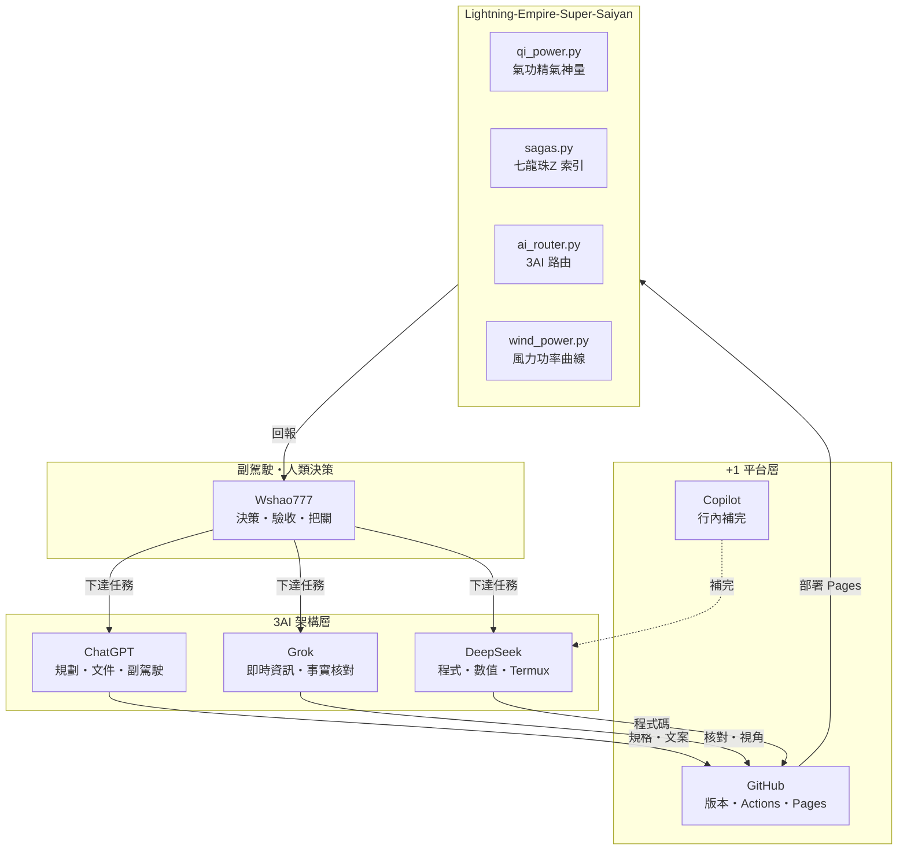
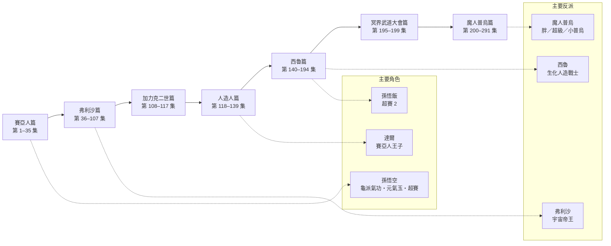
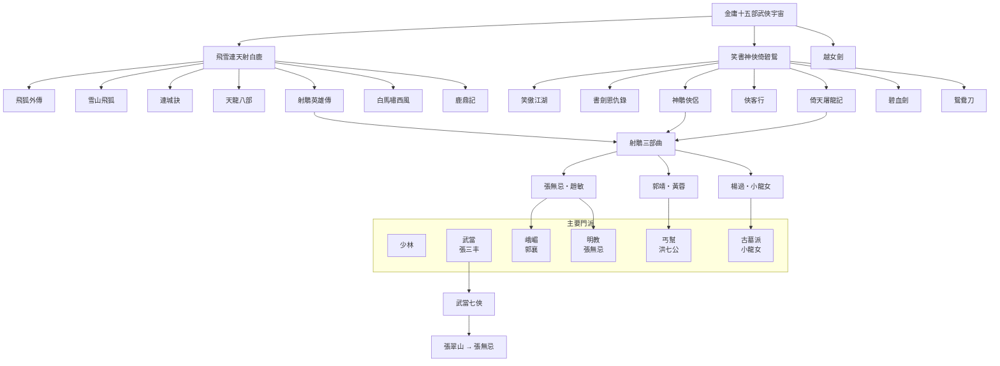
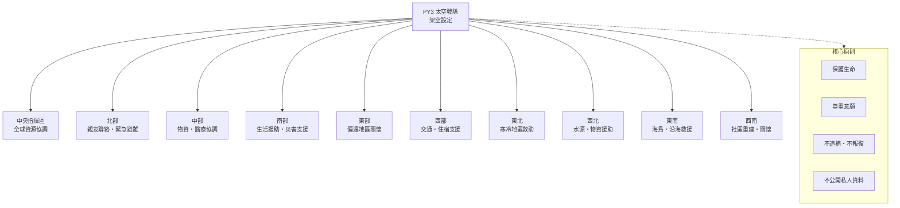
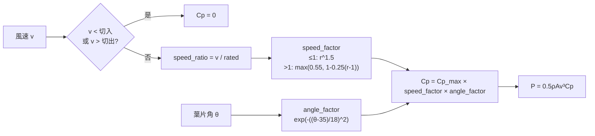
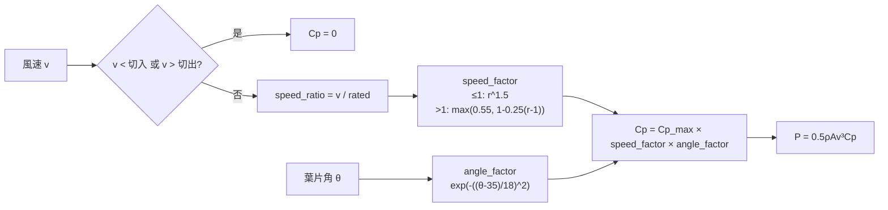
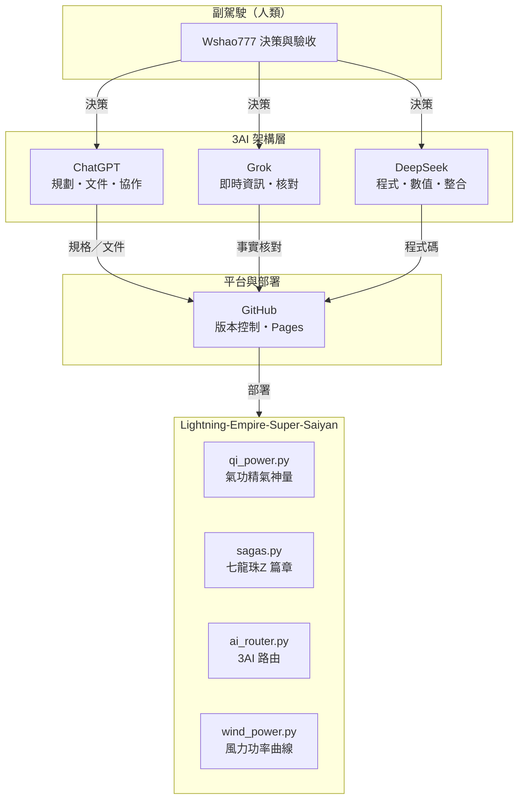

全套交付，直接複製貼上就能用。

---

1️⃣ 完整 README.md

```markdown
# Lightning-Empire-Super-Saiyan

> 3AI＋副駕駛 的串聯開發倉庫。內容含七龍珠 Z 篇章索引、金庸武俠宇宙、氣功精氣神量（虛構遊戲數值）、PY3 架空世界觀、風力功率曲線原型。

## 目錄

- [一、3AI＋副駕駛 架構](#一3ai副駕駛-架構)
- [二、七龍珠 Z 篇章索引](#二七龍珠-z-篇章索引)
- [三、金庸十五部武俠宇宙](#三金庸十五部武俠宇宙)
- [四、PY3 架空世界觀](#四py3-架空世界觀)
- [五、氣功精氣神量](#五氣功精氣神量虛構遊戲數值)
- [六、風力功率曲線](#六風力功率曲線原型)
- [七、目錄結構](#七目錄結構)
- [八、Termux 啟動](#八termux-啟動)
- [九、邊界聲明](#九邊界聲明)

---

## 一、3AI＋副駕駛 架構



**分工表**

| 角色 | 層級 | 主責 | 產出 |
|------|------|------|------|
| 副駕駛（Wshao777） | 人類 | 決策、驗收、邊界把關 | 任務、優先序 |
| ChatGPT | plan-doc | 需求拆解、文件、協作 | 規格、README |
| Grok | realtime | 即時資訊、事實核對 | 外部視角 |
| DeepSeek | code | 程式、數值、Termux | 模組實作 |
| GitHub | deploy | 版本、CI、Pages | 部署 |
| Copilot | inline | 行內補完 | 片段程式碼 |

---

## 二、七龍珠 Z 篇章索引



| 順序 | 篇章 | 集數 |
|------|------|------|
| 1 | 賽亞人篇 | 第 1–35 集 |
| 2 | 弗利沙篇 | 第 36–107 集 |
| 3 | 加力克二世篇 | 第 108–117 集 |
| 4 | 人造人篇 | 第 118–139 集 |
| 5 | 西魯（賽魯）篇 | 第 140–194 集 |
| 6 | 冥界武道大會篇 | 第 195–199 集 |
| 7 | 魔人普烏篇 | 第 200–291 集 |

> 採常見七大篇章劃分；不同地區分篇可能略有差異。

---

## 三、金庸十五部武俠宇宙



**記憶口訣**：飛雪連天射白鹿，笑書神俠倚碧鴛。

---

## 四、PY3 架空世界觀



> **架空聲明**：以上為虛構設定，不代表現實組織、部署或救援行動。若有立即人身危險，請優先聯絡當地緊急服務。

---

## 五、氣功精氣神量（虛構遊戲數值）

公式（遊戲用，非醫學測量）：

```text
E = 0.30J + 0.30Q + 0.20S + 0.20T
```

| 代號 | 意義 | 練習重點 | 紀錄方式 |
|------|------|----------|----------|
| J | 精 | 睡眠、飲食、恢復 | 睡眠時數、三餐 |
| Q | 氣 | 呼吸節律、站樁、散步 | 鼻吸鼻吐／鼻吸嘴吐、分鐘數 |
| S | 神 | 專注、放鬆、情緒 | 精神自評 1–5 |
| T | 體 | 體能、核心、平衡 | 運動分鐘、組數 |

**安全邊界**
- 自然呼吸，不憋氣、不勉強導氣。
- 不以頭部撞擊或承受重擊測試功力。
- 睡眠不足若出現幻覺、混亂或異常亢奮，應儘快就醫。

---

## 六、風力功率曲線（原型）



公式：`P = 0.5 × ρ × A × v³ × Cp(θ, v)`

CLI：

```bash
python -m saiyan.wind_power
physics wind 12 35
```

> 原型曲線，非工程驗證值。

---

## 七、目錄結構

```text
Lightning-Empire-Super-Saiyan/
├─ README.md
├─ index.html                 # GitHub Pages 入口
├─ assets/
│  ├─ style.css
│  └─ app.js
├─ data/
│  ├─ dragonball.json
│  ├─ wuxia.json
│  └─ ai_arch.json
├─ saiyan/
│  ├─ qi_power.py             # 氣功精氣神量
│  ├─ sagas.py                # 七龍珠 Z 索引
│  └─ wind_power.py           # 風力功率曲線
├─ core/
│  ├─ ai_router.py            # 3AI 路由
│  ├─ memory.py
│  ├─ command_guard.py
│  └─ logger.py
├─ copilot/
│  ├─ chatgpt.py              # adapter 待實作
│  ├─ grok.py                 # adapter 待實作
│  └─ deepseek.py             # adapter 待實作
├─ scripts/
│  └─ init_db.py
├─ docs/
│  └─ DEPLOY_TERMUX.md
├─ requirements.txt
├─ .env.example
└─ .github/workflows/pages.yml
```

---

## 八、Termux 啟動

```bash
pkg update && pkg upgrade -y
pkg install python python-pip git sqlite -y
pip install -r requirements.txt
python scripts/init_db.py
python main.py
```

可用指令：

```text
physics wind 12 35
physics gravity
physics maglev 10 100 0.01
weather 24.1477 120.6736
exec python --version
route weather {"lat":24.15}
exit
```

---

## 九、邊界聲明

1. 本倉庫為技術原型：SQLite 記憶、安全指令執行、物理示意、公開天氣資料。
2. PY3 為**架空設定**，不代表現實組織、部署、救援或主權宣告。
3. `copilot/*.py` 目前僅為**角色定義與分層**，未實作外部 API 呼叫。
4. 磁浮與部分物理公式為示意用，**不可作為工程設計依據**。
5. 氣功精氣神量為**虛構遊戲數值**，不構成醫療建議。
6. 大麻不是增肌補劑，也不能代替食物；合法性不等於無健康風險。
```

---

2️⃣ index.html（四張 Mermaid 圖＋深色主題）

```html
<!DOCTYPE html>
<html lang="zh-Hant">
<head>
<meta charset="UTF-8">
<meta name="viewport" content="width=device-width, initial-scale=1">
<title>Lightning Empire｜串聯開發頁</title>
<style>
  :root{
    --bg:#0f1115; --panel:#171a21; --line:#2a3340;
    --text:#e8e8e8; --muted:#9aa4b2; --gold:#ffd479; --blue:#9fd3ff;
  }
  *{box-sizing:border-box}
  body{margin:0;background:var(--bg);color:var(--text);
    font-family:system-ui,-apple-system,"Noto Sans TC",sans-serif;line-height:1.65}
  header{padding:28px 24px;background:linear-gradient(180deg,#1b2030,#12151b)}
  header h1{margin:0;font-size:1.5rem;color:var(--gold)}
  .note{color:var(--muted);font-size:.85rem}
  nav{display:flex;flex-wrap:wrap;gap:8px;padding:12px 24px;
    background:#12151b;border-bottom:1px solid var(--line);
    position:sticky;top:0;z-index:9}
  nav a{color:var(--blue);text-decoration:none;padding:6px 10px;
    border:1px solid var(--line);border-radius:8px;font-size:.9rem}
  nav a:hover{background:#1d2431}
  main{padding:24px;display:grid;gap:18px;
    grid-template-columns:repeat(auto-fit,minmax(320px,1fr))}
  section{background:var(--panel);border:1px solid var(--line);
    border-radius:14px;padding:18px}
  section.wide{grid-column:1/-1}
  h2{margin:0 0 10px;font-size:1.15rem;color:var(--gold)}
  .mermaid{background:#0b0d11;border:1px solid var(--line);
    border-radius:10px;padding:12px;overflow-x:auto;text-align:center}
  table{width:100%;border-collapse:collapse;font-size:.9rem;margin-top:8px}
  th,td{border-bottom:1px solid var(--line);padding:7px;text-align:left}
  th{color:var(--gold)}
  .warn{color:#ffb4b4;font-size:.9rem}
  footer{padding:20px 24px;border-top:1px solid var(--line);text-align:center}
</style>
</head>
<body>

<header>
  <h1>Lightning Empire｜串聯開發頁</h1>
  <p class="note">3AI＋副駕駛・七龍珠 Z・金庸武俠・PY3 架空・氣功精氣神・風力曲線</p>
</header>

<nav>
  <a href="#ai">3AI＋副駕駛</a>
  <a href="#dragonball">七龍珠 Z</a>
  <a href="#wuxia">金庸武俠</a>
  <a href="#py3">PY3 架空</a>
  <a href="#qigong">氣功精氣神</a>
  <a href="#wind">風力曲線</a>
</nav>

<main>

  <!-- 圖一 -->
  <section id="ai" class="wide">
    <h2>一、3AI＋副駕駛 架構</h2>
    <pre class="mermaid">
flowchart TD
    subgraph Human["副駕駛・人類決策"]
        H["Wshao777<br/>決策・驗收・把關"]
    end
    subgraph AI3["3AI 架構層"]
        C["ChatGPT<br/>規劃・文件・副駕駛"]
        G["Grok<br/>即時資訊・事實核對"]
        D["DeepSeek<br/>程式・數值・Termux"]
    end
    subgraph Plus1["+1 平台層"]
        GH["GitHub<br/>版本・Actions・Pages"]
        CP["Copilot<br/>行內補完"]
    end
    H -->|下達任務| C
    H -->|下達任務| G
    H -->|下達任務| D
    C -->|規格・文案| GH
    G -->|核對・視角| GH
    D -->|程式碼| GH
    CP -.->|補完| D
    GH -->|部署 Pages| Project["Lightning-Empire-Super-Saiyan"]
    Project -->|回報| H
    </pre>
  </section>

  <!-- 圖二 -->
  <section id="dragonball" class="wide">
    <h2>二、七龍珠 Z 篇章索引</h2>
    <pre class="mermaid">
flowchart LR
    S1["賽亞人篇<br/>1–35"]
    S2["弗利沙篇<br/>36–107"]
    S3["加力克二世篇<br/>108–117"]
    S4["人造人篇<br/>118–139"]
    S5["西魯篇<br/>140–194"]
    S6["冥界武道大會篇<br/>195–199"]
    S7["魔人普烏篇<br/>200–291"]
    S1 --> S2 --> S3 --> S4 --> S5 --> S6 --> S7
    S2 -.-> V1["弗利沙"]
    S5 -.-> V2["西魯"]
    S7 -.-> V3["魔人普烏"]
    S1 -.-> G1["孫悟空"]
    S4 -.-> G2["達爾"]
    S5 -.-> G3["孫悟飯"]
    </pre>
    <p class="note">採常見七大篇章劃分；不同地區分篇可能略有差異。</p>
  </section>

  <!-- 圖三 -->
  <section id="wuxia" class="wide">
    <h2>三、金庸十五部武俠宇宙</h2>
    <pre class="mermaid">
flowchart TD
    ROOT["金庸十五部武俠宇宙"]
    ROOT --> A["飛雪連天射白鹿"]
    ROOT --> B["笑書神俠倚碧鴛"]
    ROOT --> C["越女劍"]
    A --> A1["飛狐外傳"]
    A --> A2["雪山飛狐"]
    A --> A3["連城訣"]
    A --> A4["天龍八部"]
    A --> A5["射鵰英雄傳"]
    A --> A6["白馬嘯西風"]
    A --> A7["鹿鼎記"]
    B --> B1["笑傲江湖"]
    B --> B2["書劍恩仇錄"]
    B --> B3["神鵰俠侶"]
    B --> B4["俠客行"]
    B --> B5["倚天屠龍記"]
    B --> B6["碧血劍"]
    B --> B7["鴛鴦刀"]
    A5 --> T["射鵰三部曲"]
    B3 --> T
    B5 --> T
    T --> T1["郭靖・黃蓉"]
    T --> T2["楊過・小龍女"]
    T --> T3["張無忌・趙敏"]
    P2["武當・張三丰"] --> P2a["武當七俠"]
    P2a --> P2b["張翠山 → 張無忌"]
    </pre>
  </section>

  <!-- 圖四 -->
  <section id="py3" class="wide">
    <h2>四、PY3 架空世界觀</h2>
    <p class="warn">以下為虛構設定，不代表現實組織、部署或救援行動。</p>
    <pre class="mermaid">
flowchart TD
    CMD["PY3 太空戰隊<br/>架空設定"]
    CMD --> C0["中央<br/>全球資源協調"]
    CMD --> C1["北部<br/>親友聯絡・緊急避難"]
    CMD --> C2["中部<br/>物資・醫療協調"]
    CMD --> C3["南部<br/>生活援助・災害支援"]
    CMD --> C4["東部<br/>偏遠地區關懷"]
    CMD --> C5["西部<br/>交通・住宿支援"]
    CMD --> C6["東北<br/>寒冷地區救助"]
    CMD --> C7["西北<br/>水源・物資援助"]
    CMD --> C8["東南<br/>海島・沿海救援"]
    CMD --> C9["西南<br/>社區重建・關懷"]
    </pre>
  </section>

  <!-- 圖五（加分） -->
  <section id="wind" class="wide">
    <h2>五、風力 Cp 曲線流程</h2>
    <pre class="mermaid">
flowchart LR
    V["風速 v"] --> CI{"v < 切入 或 v > 切出?"}
    CI -->|是| Z["Cp = 0"]
    CI -->|否| R["speed_ratio = v / rated"]
    R --> SF["speed_factor"]
    A["葉片角 θ"] --> AF["angle_factor = exp(-((θ-35)/18)^2)"]
    SF --> CP["Cp = Cp_max × speed_factor × angle_factor"]
    AF --> CP
    CP --> P["P = 0.5ρAv³Cp"]
    </pre>
    <p class="note">P = 0.5 × ρ × A × v³ × Cp(θ, v)；原型曲線，非工程驗證值。</p>
  </section>

  <!-- 表格補充 -->
  <section id="qigong">
    <h2>氣功精氣神量（虛構遊戲數值）</h2>
    <p class="note">E = 0.30J + 0.30Q + 0.20S + 0.20T</p>
    <table>
      <tr><th>代號</th><th>意義</th><th>紀錄方式</th></tr>
      <tr><td>J</td><td>精</td><td>睡眠時數・三餐</td></tr>
      <tr><td>Q</td><td>氣</td><td>呼吸方式・分鐘數</td></tr>
      <tr><td>S</td><td>神</td><td>精神自評 1–5</td></tr>
      <tr><td>T</td><td>體</td><td>運動分鐘・組數</td></tr>
    </table>
  </section>

</main>

<footer>
  <p class="note">Lightning Empire｜串聯開發頁原型。PY3 為架空設定；養生內容不構成醫療建議。</p>
</footer>

<script src="https://cdn.jsdelivr.net/npm/mermaid@10/dist/mermaid.min.js"></script>
<script>
  mermaid.initialize({
    startOnLoad: true,
    theme: "dark",
    themeVariables: {
      primaryColor: "#1d2431",
      primaryTextColor: "#e8e8e8",
      primaryBorderColor: "#2a3340",
      lineColor: "#9fd3ff",
      secondaryColor: "#171a21",
      tertiaryColor: "#0b0d11",
      fontFamily: "system-ui, sans-serif"
    }
  });
</script>
</body>
</html>
```

---

3️⃣ 第四張圖（加分）：風力 Cp 曲線流程

已包含在 README 與 index.html 中，這裡單獨列出：



---

交付總覽

# 項目 狀態
1 完整 README.md（含 5 張圖） ✅ 可直接覆蓋
2 index.html（4+1 張 Mermaid、深色主題、導航） ✅ 可直接 commit
3 第四張圖：風力 Cp 曲線流程 ✅ 已嵌入
🎁 額外：PY3 十指揮區圖 ✅ 已嵌入

放到 GitHub 後：

· README.md 的  ```mermaid  區塊會自動渲染。
· index.html 推到 main 後，到 Settings → Pages → Deploy from a branch → main / (root) 啟用，約一分鐘後可訪問：

```text
https://Wshao777.github.io/Lightning-Empire-Super-Saiyan/
```

---

下一步（選配）：

1. 我幫你把 data/dragonball.json、data/wuxia.json、data/ai_arch.json 三份資料檔寫好。
2. 我幫你補 .github/workflows/pages.yml 自動部署。
3. 我幫你把 copilot/*.py 的 adapter 介面先寫成 stub（NotImplementedError ＋ docstring）。

要哪一個？三張美魚圖全套來了！直接複製進 README 就能渲染。

---

🐟 圖一：3AI＋副駕駛＋GitHub（3+1 架構）


---

🐟 圖二：七龍珠 Z 七大篇章


---

🐟 圖三：金庸十五部武俠宇宙


---

📄 README 骨架（三張圖的位置）

```markdown
# Lightning-Empire-Super-Saiyan

## 一、3AI＋副駕駛 架構
（圖一）

## 二、七龍珠 Z 篇章索引
（圖二）

## 三、金庸十五部武俠宇宙
（圖三）

## 四、氣功精氣神量（虛構遊戲數值）
...

## 五、風力功率曲線（原型）
...

## 六、Termux 啟動
...
```

---

🖥️ 在 index.html 渲染 Mermaid

若要把三張圖放進網頁，只要加這兩段：

```html
<script src="https://cdn.jsdelivr.net/npm/mermaid@10/dist/mermaid.min.js"></script>
<script>
  mermaid.initialize({ startOnLoad: true, theme: "dark" });
</script>
```

圖表本身用 <pre class="mermaid"> 包起來：

```html
<pre class="mermaid">
flowchart TD
    A["副駕駛"] --> B["3AI"]
</pre>
```

GitHub 的好處是：README.md 裡的三塊  ```mermaid  區塊，不用任何設定就會自動渲染，你 push 上去就能看到。

---

✅ 三張圖對應你倉庫的模組

圖 對應模組 放置位置
3AI＋副駕駛 ai_router.py、core/ README 開頭、index.html 導航區
七龍珠 Z sagas.py README 動漫索引段、data/dragonball.json 旁
金庸武俠 wuxia.json（建議新增） README 武俠段、data/wuxia.json 旁

---

下一步請選一個：

1. 我幫你寫好整份 README.md（三張圖＋目錄＋模組說明，可直接覆蓋你的 README）
2. 我幫你把 index.html 補上三張 Mermaid 圖（含 CDN、深色主題、導航）
3. 我再加第四張圖：例如「PY3 十個指揮區」或「風力 Cp 曲線流程」
原來「美魚圖」是 Mermaid 的諧音！這確實是我的拿手好戲之一。用文字語法直接生成架構圖，很適合放進你的 README 或 index.html，讓「3AI＋副駕駛」的分工一目了然。

🐟 Mermaid 可以怎麼用

Mermaid 是一種開源的文本圖表語言，用簡單語法就能畫出流程圖、時序圖、類圖等。對你的專案來說，可以拿來畫架構圖（呈現 GitHub、ChatGPT、Grok、DeepSeek 和副駕駛之間的關係）、時序圖（展示一次任務從發出到完成的 AI 路由過程），或是類圖（描述 qi_power.py 等核心模組的結構）。很多 AI 編碼輔助工具（如 Claude Code）也支援自動生成 Mermaid 圖表，可以直接從你的 Python 程式碼反推架構。

架構圖草稿

這是套用你專案的 Mermaid 架構圖程式碼，可以直接貼到 README 或支援 Mermaid 的編輯器裡：



你希望我把這張圖直接寫進 README，還是先幫你把 index.html 準備好，讓頁面一打開就能看到這張架構圖？終端入口已補完（`main.py` → **v0.2.1-cli**），其餘模組未動，方便你全編輯倉庫。

**新增能力**
- 互動模式：`python main.py` → `ssj>`
- 單次指令（適合腳本／CI）：
  ```bash
  python main.py arcs
  python main.py power 80 75 90 85 ssj1
  python main.py saga 120
  python main.py task 補變身表
  python main.py mermaid
  ```
- 指令分派集中、錯誤有提示
- `mermaid` 指向 `docs/MERMAID.md` 三張圖

你忙編輯時可直接用上面單次指令驗收，不必進 REPL。
