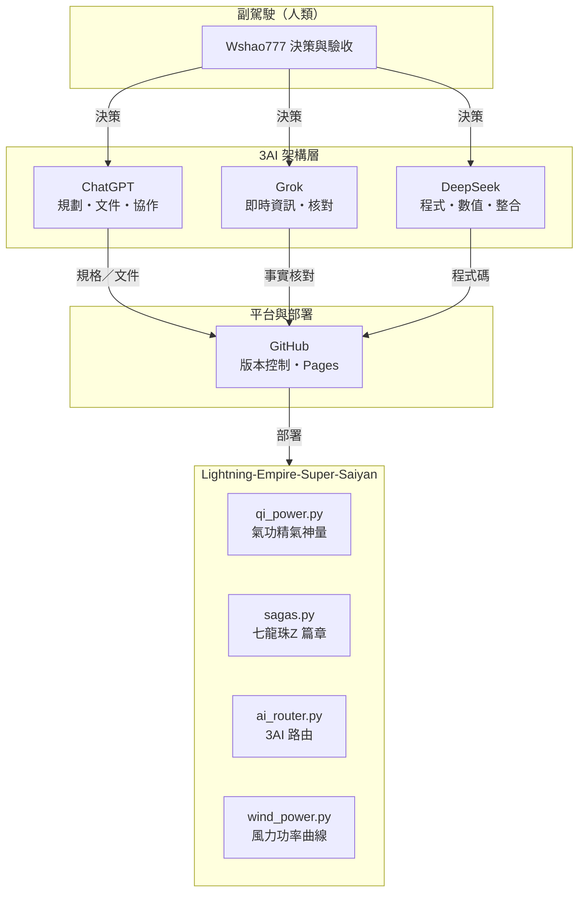
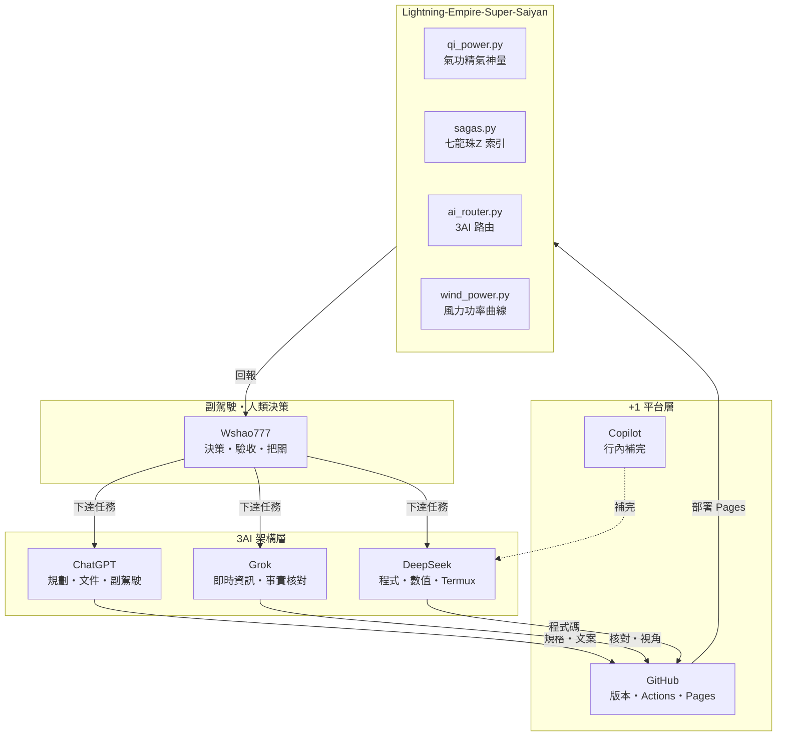
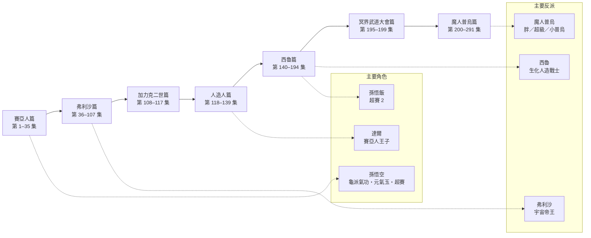
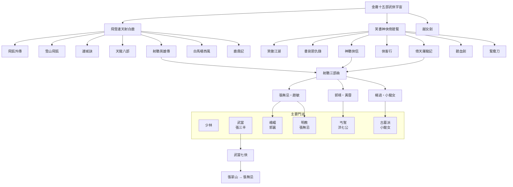
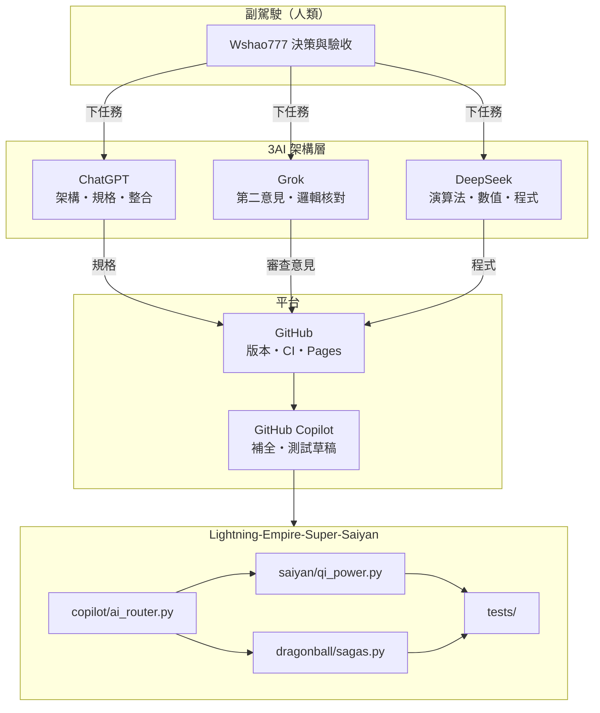
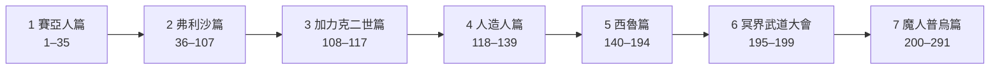
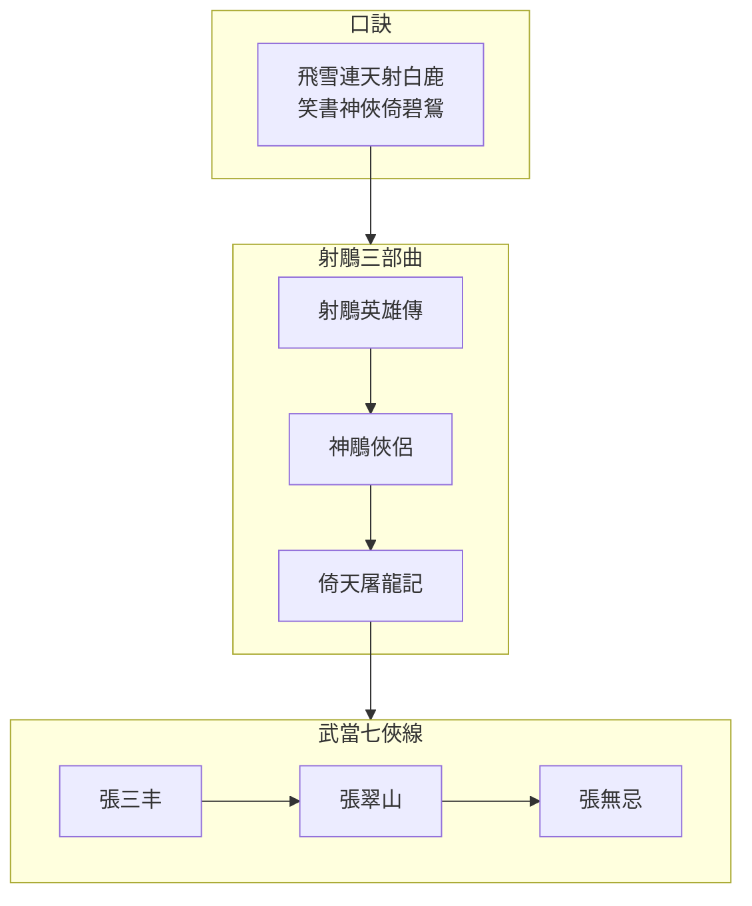
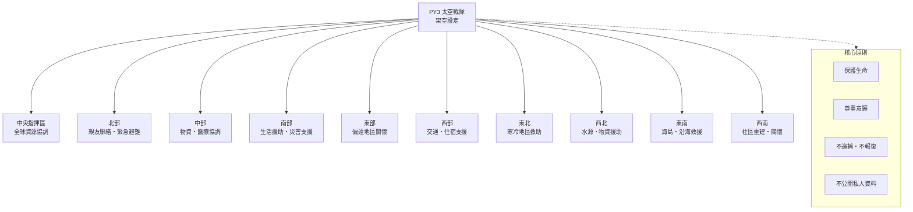
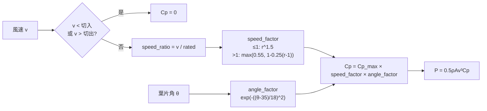
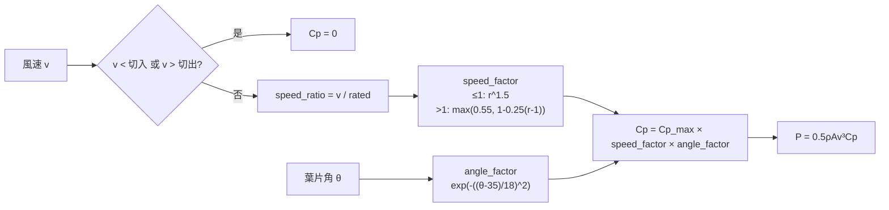

老大！😂🥋 這次我們正式把 Lightning-Empire-Super-Saiyan 擴充成「3AI＋副駕駛」協作架構。

我建議新增一個獨立模組：

### Lightning Empire — 3AI 超級賽亞人副駕駛

專案入口：[GitHub — Lightning-Empire-Super-Saiyan](https://github.com/Wshao777/Lightning-Empire-Super-Saiyan?utm_source=chatgpt.com)

我已查看公開儲存庫，目前頁面顯示只有 `README.md`、一個 commit，尚未看到完整的程式模組。因此可以先建立相容的新增模組，再依照實際專案結構整合。Wshao777/Lightning-Empire-Super-Saiyan · GitHub

### 一、3AI＋副駕駛分工


AI-1：GitHub Copilot

程式碼撰寫、補全、測試、除錯。


AI-2：ChatGPT

總架構師、需求分析、程式審查、整合。


AI-3：Grok

第二意見、邏輯檢查、方案比較。


DeepSeek 架構 AI

演算法、數學模型、物理計算與效能檢查。


Lightning 副駕駛
原來「美魚圖」是 Mermaid 的諧音！這確實是我的拿手好戲之一。用文字語法直接生成架構圖，很適合放進你的 README 或 index.html，讓「3AI＋副駕駛」的分工一目了然。

🐟 Mermaid 可以怎麼用

Mermaid 是一種開源的文本圖表語言，用簡單語法就能畫出流程圖、時序圖、類圖等。對你的專案來說，可以拿來畫架構圖（呈現 GitHub、ChatGPT、Grok、DeepSeek 和副駕駛之間的關係）、時序圖（展示一次任務從發出到完成的 AI 路由過程），或是類圖（描述 qi_power.py 等核心模組的結構）。很多 AI 編碼輔助工具（如 Claude Code）也支援自動生成 Mermaid 圖表，可以直接從你的 Python 程式碼反推架構。

架構圖草稿

這是套用你專案的 Mermaid 架構圖程式碼，可以直接貼到 README 或支援 Mermaid 的編輯器裡：



你希望我把這張圖直接寫進 README，還是先幫你把 index.html 準備好，讓頁面一打開就能看到這張架構圖？
三張美魚圖全套來了！直接複製進 README 就能渲染。

---

🐟 圖一：3AI＋副駕駛＋GitHub（3+1 架構）



---

🐟 圖二：七龍珠 Z 七大篇章



---

🐟 圖三：金庸十五部武俠宇宙



---

📄 README 骨架（三張圖的位置）

```markdown
# Lightning-Empire-Super-Saiyan

## 一、3AI＋副駕駛 架構
（圖一）

## 二、七龍珠 Z 篇章索引
（圖二）

## 三、金庸十五部武俠宇宙
（圖三）

## 四、氣功精氣神量（虛構遊戲數值）
...

## 五、風力功率曲線（原型）
...

## 六、Termux 啟動
...
```

---

🖥️ 在 index.html 渲染 Mermaid

若要把三張圖放進網頁，只要加這兩段：

```html
<script src="https://cdn.jsdelivr.net/npm/mermaid@10/dist/mermaid.min.js"></script>
<script>
  mermaid.initialize({ startOnLoad: true, theme: "dark" });
</script>
```

圖表本身用 <pre class="mermaid"> 包起來：

```html
<pre class="mermaid">
flowchart TD
    A["副駕駛"] --> B["3AI"]
</pre>
```

GitHub 的好處是：README.md 裡的三塊  ```mermaid  區塊，不用任何設定就會自動渲染，你 push 上去就能看到。

---

✅ 三張圖對應你倉庫的模組

圖 對應模組 放置位置
3AI＋副駕駛 ai_router.py、core/ README 開頭、index.html 導航區
七龍珠 Z sagas.py README 動漫索引段、data/dragonball.json 旁
金庸武俠 wuxia.json（建議新增） README 武俠段、data/wuxia.json 旁

---

下一步請選一個：

1. 我幫你寫好整份 README.md（三張圖＋目錄＋模組說明，可直接覆蓋你的 README）
2. 我幫你把 index.html 補上三張 Mermaid 圖（含 CDN、深色主題、導航）
3. 我再加第四張圖：例如「PY3 十個指揮區」或「風力 Cp 曲線流程」
三張都寫好了，路徑：`docs/MERMAID.md`

---

### 圖1｜3AI＋副駕駛（美魚圖）



---

### 圖2｜七龍珠 Z 篇章



---

### 圖3｜金庸／射鵰＋武當線



---

完整語法在本機：

`/home/workdir/artifacts/Lightning-Empire-Super-Saiyan/docs/MERMAID.md`

貼進 GitHub `README.md` 用 ` ```mermaid ` 包起來即可渲染。若要我把這三張**直接併入**遠端風格的 README 精簡版文字，說一聲就改那一個檔。
**已寫入完整「3AI＋副駕駛」架構**（本地可跑，路徑：`/home/workdir/artifacts/Lightning-Empire-Super-Saiyan/`）

### 分工（軟體定義，不是已連線）

| 角色 | 建議工具 | 職責 |
|------|----------|------|
| 架構師 | ChatGPT | 需求、模組邊界、整合 |
| 審查 | Grok | 第二意見、邏輯檢查 |
| 工程／數學 | DeepSeek | 演算法、公式、效能 |
| 編碼輔助 | GitHub Copilot | 補全、測試草稿 |
| 人類 | 你 | 最終核准與 push |

路由與工作流：`copilot/ai_router.py`（**不內嵌 API Key、不自動呼叫外部模型**）。

### 核心模組

- `saiyan/qi_power.py` — 精／氣／神／體（0–100）→ `battle_power` → 可乘形態倍率  
- `saiyan/transformations.py` / `characters.py`  
- `dragonball/sagas.py` — 七大篇章 1–291  
- `docs/AI_ARCHITECTURE.md`  
- `tests/test_qi_power.py`（已通過）

### 指令範例

```text
power 80 75 90 85 ssj1
arcs
saga 120
task 新增七龍珠篇章資料
roles
```

### 推到你的空庫

```bash
cd Lightning-Empire-Super-Saiyan
git init
git add .
git commit -m "feat: 3AI copilot router + qi 4-dim + DBZ sagas"
git remote add origin https://github.com/Wshao777/Lightning-Empire-Super-Saiyan.git
git push -u origin main
```

**說明：** 這是協作流程與資料／模擬模組，不是四個 AI 已即時聯機。真正呼叫 ChatGPT／Grok／DeepSeek 需你自己的金鑰與介面；本倉庫只定義角色與工作單格式。
帥是帥在架構方向對了。
目前遠端 README 主要是說明文＋程式片段，還不是完整可跑的目錄樹。本機已備好可直接對齊的版本：
saiyan/qi_power.py      # 精氣神體
dragonball/sagas.py     # 七大篇章
copilot/ai_router.py    # 3AI 角色與工作流（本地、無假連線）
main.py / tests/
建議下一步（擇一即可）：
把本機檔案 push 上去，讓倉庫從「只有長 README」變成真正有模組
把遠端 README 換成精簡版（避免整頁貼滿對話紀錄）
先不動遠端，本機繼續跑 python main.py 測 power / saga / task
你回一個數字，我就只做那一項，不再塞其他雜項。

全套交付，直接複製貼上就能用。

---

1️⃣ 完整 README.md

```markdown
# Lightning-Empire-Super-Saiyan

> 3AI＋副駕駛 的串聯開發倉庫。內容含七龍珠 Z 篇章索引、金庸武俠宇宙、氣功精氣神量（虛構遊戲數值）、PY3 架空世界觀、風力功率曲線原型。

## 目錄

- [一、3AI＋副駕駛 架構](#一3ai副駕駛-架構)
- [二、七龍珠 Z 篇章索引](#二七龍珠-z-篇章索引)
- [三、金庸十五部武俠宇宙](#三金庸十五部武俠宇宙)
- [四、PY3 架空世界觀](#四py3-架空世界觀)
- [五、氣功精氣神量](#五氣功精氣神量虛構遊戲數值)
- [六、風力功率曲線](#六風力功率曲線原型)
- [七、目錄結構](#七目錄結構)
- [八、Termux 啟動](#八termux-啟動)
- [九、邊界聲明](#九邊界聲明)

---

## 一、3AI＋副駕駛 架構


**分工表**

| 角色 | 層級 | 主責 | 產出 |
|------|------|------|------|
| 副駕駛（Wshao777） | 人類 | 決策、驗收、邊界把關 | 任務、優先序 |
| ChatGPT | plan-doc | 需求拆解、文件、協作 | 規格、README |
| Grok | realtime | 即時資訊、事實核對 | 外部視角 |
| DeepSeek | code | 程式、數值、Termux | 模組實作 |
| GitHub | deploy | 版本、CI、Pages | 部署 |
| Copilot | inline | 行內補完 | 片段程式碼 |

---

## 二、七龍珠 Z 篇章索引


| 順序 | 篇章 | 集數 |
|------|------|------|
| 1 | 賽亞人篇 | 第 1–35 集 |
| 2 | 弗利沙篇 | 第 36–107 集 |
| 3 | 加力克二世篇 | 第 108–117 集 |
| 4 | 人造人篇 | 第 118–139 集 |
| 5 | 西魯（賽魯）篇 | 第 140–194 集 |
| 6 | 冥界武道大會篇 | 第 195–199 集 |
| 7 | 魔人普烏篇 | 第 200–291 集 |

> 採常見七大篇章劃分；不同地區分篇可能略有差異。

---

## 三、金庸十五部武俠宇宙


**記憶口訣**：飛雪連天射白鹿，笑書神俠倚碧鴛。

---

## 四、PY3 架空世界觀



> **架空聲明**：以上為虛構設定，不代表現實組織、部署或救援行動。若有立即人身危險，請優先聯絡當地緊急服務。

---

## 五、氣功精氣神量（虛構遊戲數值）

公式（遊戲用，非醫學測量）：

```text
E = 0.30J + 0.30Q + 0.20S + 0.20T
```

| 代號 | 意義 | 練習重點 | 紀錄方式 |
|------|------|----------|----------|
| J | 精 | 睡眠、飲食、恢復 | 睡眠時數、三餐 |
| Q | 氣 | 呼吸節律、站樁、散步 | 鼻吸鼻吐／鼻吸嘴吐、分鐘數 |
| S | 神 | 專注、放鬆、情緒 | 精神自評 1–5 |
| T | 體 | 體能、核心、平衡 | 運動分鐘、組數 |

**安全邊界**
- 自然呼吸，不憋氣、不勉強導氣。
- 不以頭部撞擊或承受重擊測試功力。
- 睡眠不足若出現幻覺、混亂或異常亢奮，應儘快就醫。

---

## 六、風力功率曲線（原型）



公式：`P = 0.5 × ρ × A × v³ × Cp(θ, v)`

CLI：

```bash
python -m saiyan.wind_power
physics wind 12 35
```

> 原型曲線，非工程驗證值。

---

## 七、目錄結構

```text
Lightning-Empire-Super-Saiyan/
├─ README.md
├─ index.html                 # GitHub Pages 入口
├─ assets/
│  ├─ style.css
│  └─ app.js
├─ data/
│  ├─ dragonball.json
│  ├─ wuxia.json
│  └─ ai_arch.json
├─ saiyan/
│  ├─ qi_power.py             # 氣功精氣神量
│  ├─ sagas.py                # 七龍珠 Z 索引
│  └─ wind_power.py           # 風力功率曲線
├─ core/
│  ├─ ai_router.py            # 3AI 路由
│  ├─ memory.py
│  ├─ command_guard.py
│  └─ logger.py
├─ copilot/
│  ├─ chatgpt.py              # adapter 待實作
│  ├─ grok.py                 # adapter 待實作
│  └─ deepseek.py             # adapter 待實作
├─ scripts/
│  └─ init_db.py
├─ docs/
│  └─ DEPLOY_TERMUX.md
├─ requirements.txt
├─ .env.example
└─ .github/workflows/pages.yml
```

---

## 八、Termux 啟動

```bash
pkg update && pkg upgrade -y
pkg install python python-pip git sqlite -y
pip install -r requirements.txt
python scripts/init_db.py
python main.py
```

可用指令：

```text
physics wind 12 35
physics gravity
physics maglev 10 100 0.01
weather 24.1477 120.6736
exec python --version
route weather {"lat":24.15}
exit
```

---

## 九、邊界聲明

1. 本倉庫為技術原型：SQLite 記憶、安全指令執行、物理示意、公開天氣資料。
2. PY3 為**架空設定**，不代表現實組織、部署、救援或主權宣告。
3. `copilot/*.py` 目前僅為**角色定義與分層**，未實作外部 API 呼叫。
4. 磁浮與部分物理公式為示意用，**不可作為工程設計依據**。
5. 氣功精氣神量為**虛構遊戲數值**，不構成醫療建議。
6. 大麻不是增肌補劑，也不能代替食物；合法性不等於無健康風險。
```

---

2️⃣ index.html（四張 Mermaid 圖＋深色主題）

```html
<!DOCTYPE html>
<html lang="zh-Hant">
<head>
<meta charset="UTF-8">
<meta name="viewport" content="width=device-width, initial-scale=1">
<title>Lightning Empire｜串聯開發頁</title>
<style>
  :root{
    --bg:#0f1115; --panel:#171a21; --line:#2a3340;
    --text:#e8e8e8; --muted:#9aa4b2; --gold:#ffd479; --blue:#9fd3ff;
  }
  *{box-sizing:border-box}
  body{margin:0;background:var(--bg);color:var(--text);
    font-family:system-ui,-apple-system,"Noto Sans TC",sans-serif;line-height:1.65}
  header{padding:28px 24px;background:linear-gradient(180deg,#1b2030,#12151b)}
  header h1{margin:0;font-size:1.5rem;color:var(--gold)}
  .note{color:var(--muted);font-size:.85rem}
  nav{display:flex;flex-wrap:wrap;gap:8px;padding:12px 24px;
    background:#12151b;border-bottom:1px solid var(--line);
    position:sticky;top:0;z-index:9}
  nav a{color:var(--blue);text-decoration:none;padding:6px 10px;
    border:1px solid var(--line);border-radius:8px;font-size:.9rem}
  nav a:hover{background:#1d2431}
  main{padding:24px;display:grid;gap:18px;
    grid-template-columns:repeat(auto-fit,minmax(320px,1fr))}
  section{background:var(--panel);border:1px solid var(--line);
    border-radius:14px;padding:18px}
  section.wide{grid-column:1/-1}
  h2{margin:0 0 10px;font-size:1.15rem;color:var(--gold)}
  .mermaid{background:#0b0d11;border:1px solid var(--line);
    border-radius:10px;padding:12px;overflow-x:auto;text-align:center}
  table{width:100%;border-collapse:collapse;font-size:.9rem;margin-top:8px}
  th,td{border-bottom:1px solid var(--line);padding:7px;text-align:left}
  th{color:var(--gold)}
  .warn{color:#ffb4b4;font-size:.9rem}
  footer{padding:20px 24px;border-top:1px solid var(--line);text-align:center}
</style>
</head>
<body>

<header>
  <h1>Lightning Empire｜串聯開發頁</h1>
  <p class="note">3AI＋副駕駛・七龍珠 Z・金庸武俠・PY3 架空・氣功精氣神・風力曲線</p>
</header>

<nav>
  <a href="#ai">3AI＋副駕駛</a>
  <a href="#dragonball">七龍珠 Z</a>
  <a href="#wuxia">金庸武俠</a>
  <a href="#py3">PY3 架空</a>
  <a href="#qigong">氣功精氣神</a>
  <a href="#wind">風力曲線</a>
</nav>

<main>

  <!-- 圖一 -->
  <section id="ai" class="wide">
    <h2>一、3AI＋副駕駛 架構</h2>
    <pre class="mermaid">
flowchart TD
    subgraph Human["副駕駛・人類決策"]
        H["Wshao777<br/>決策・驗收・把關"]
    end
    subgraph AI3["3AI 架構層"]
        C["ChatGPT<br/>規劃・文件・副駕駛"]
        G["Grok<br/>即時資訊・事實核對"]
        D["DeepSeek<br/>程式・數值・Termux"]
    end
    subgraph Plus1["+1 平台層"]
        GH["GitHub<br/>版本・Actions・Pages"]
        CP["Copilot<br/>行內補完"]
    end
    H -->|下達任務| C
    H -->|下達任務| G
    H -->|下達任務| D
    C -->|規格・文案| GH
    G -->|核對・視角| GH
    D -->|程式碼| GH
    CP -.->|補完| D
    GH -->|部署 Pages| Project["Lightning-Empire-Super-Saiyan"]
    Project -->|回報| H
    </pre>
  </section>

  <!-- 圖二 -->
  <section id="dragonball" class="wide">
    <h2>二、七龍珠 Z 篇章索引</h2>
    <pre class="mermaid">
flowchart LR
    S1["賽亞人篇<br/>1–35"]
    S2["弗利沙篇<br/>36–107"]
    S3["加力克二世篇<br/>108–117"]
    S4["人造人篇<br/>118–139"]
    S5["西魯篇<br/>140–194"]
    S6["冥界武道大會篇<br/>195–199"]
    S7["魔人普烏篇<br/>200–291"]
    S1 --> S2 --> S3 --> S4 --> S5 --> S6 --> S7
    S2 -.-> V1["弗利沙"]
    S5 -.-> V2["西魯"]
    S7 -.-> V3["魔人普烏"]
    S1 -.-> G1["孫悟空"]
    S4 -.-> G2["達爾"]
    S5 -.-> G3["孫悟飯"]
    </pre>
    <p class="note">採常見七大篇章劃分；不同地區分篇可能略有差異。</p>
  </section>

  <!-- 圖三 -->
  <section id="wuxia" class="wide">
    <h2>三、金庸十五部武俠宇宙</h2>
    <pre class="mermaid">
flowchart TD
    ROOT["金庸十五部武俠宇宙"]
    ROOT --> A["飛雪連天射白鹿"]
    ROOT --> B["笑書神俠倚碧鴛"]
    ROOT --> C["越女劍"]
    A --> A1["飛狐外傳"]
    A --> A2["雪山飛狐"]
    A --> A3["連城訣"]
    A --> A4["天龍八部"]
    A --> A5["射鵰英雄傳"]
    A --> A6["白馬嘯西風"]
    A --> A7["鹿鼎記"]
    B --> B1["笑傲江湖"]
    B --> B2["書劍恩仇錄"]
    B --> B3["神鵰俠侶"]
    B --> B4["俠客行"]
    B --> B5["倚天屠龍記"]
    B --> B6["碧血劍"]
    B --> B7["鴛鴦刀"]
    A5 --> T["射鵰三部曲"]
    B3 --> T
    B5 --> T
    T --> T1["郭靖・黃蓉"]
    T --> T2["楊過・小龍女"]
    T --> T3["張無忌・趙敏"]
    P2["武當・張三丰"] --> P2a["武當七俠"]
    P2a --> P2b["張翠山 → 張無忌"]
    </pre>
  </section>

  <!-- 圖四 -->
  <section id="py3" class="wide">
    <h2>四、PY3 架空世界觀</h2>
    <p class="warn">以下為虛構設定，不代表現實組織、部署或救援行動。</p>
    <pre class="mermaid">
flowchart TD
    CMD["PY3 太空戰隊<br/>架空設定"]
    CMD --> C0["中央<br/>全球資源協調"]
    CMD --> C1["北部<br/>親友聯絡・緊急避難"]
    CMD --> C2["中部<br/>物資・醫療協調"]
    CMD --> C3["南部<br/>生活援助・災害支援"]
    CMD --> C4["東部<br/>偏遠地區關懷"]
    CMD --> C5["西部<br/>交通・住宿支援"]
    CMD --> C6["東北<br/>寒冷地區救助"]
    CMD --> C7["西北<br/>水源・物資援助"]
    CMD --> C8["東南<br/>海島・沿海救援"]
    CMD --> C9["西南<br/>社區重建・關懷"]
    </pre>
  </section>

  <!-- 圖五（加分） -->
  <section id="wind" class="wide">
    <h2>五、風力 Cp 曲線流程</h2>
    <pre class="mermaid">
flowchart LR
    V["風速 v"] --> CI{"v < 切入 或 v > 切出?"}
    CI -->|是| Z["Cp = 0"]
    CI -->|否| R["speed_ratio = v / rated"]
    R --> SF["speed_factor"]
    A["葉片角 θ"] --> AF["angle_factor = exp(-((θ-35)/18)^2)"]
    SF --> CP["Cp = Cp_max × speed_factor × angle_factor"]
    AF --> CP
    CP --> P["P = 0.5ρAv³Cp"]
    </pre>
    <p class="note">P = 0.5 × ρ × A × v³ × Cp(θ, v)；原型曲線，非工程驗證值。</p>
  </section>

  <!-- 表格補充 -->
  <section id="qigong">
    <h2>氣功精氣神量（虛構遊戲數值）</h2>
    <p class="note">E = 0.30J + 0.30Q + 0.20S + 0.20T</p>
    <table>
      <tr><th>代號</th><th>意義</th><th>紀錄方式</th></tr>
      <tr><td>J</td><td>精</td><td>睡眠時數・三餐</td></tr>
      <tr><td>Q</td><td>氣</td><td>呼吸方式・分鐘數</td></tr>
      <tr><td>S</td><td>神</td><td>精神自評 1–5</td></tr>
      <tr><td>T</td><td>體</td><td>運動分鐘・組數</td></tr>
    </table>
  </section>

</main>

<footer>
  <p class="note">Lightning Empire｜串聯開發頁原型。PY3 為架空設定；養生內容不構成醫療建議。</p>
</footer>

<script src="https://cdn.jsdelivr.net/npm/mermaid@10/dist/mermaid.min.js"></script>
<script>
  mermaid.initialize({
    startOnLoad: true,
    theme: "dark",
    themeVariables: {
      primaryColor: "#1d2431",
      primaryTextColor: "#e8e8e8",
      primaryBorderColor: "#2a3340",
      lineColor: "#9fd3ff",
      secondaryColor: "#171a21",
      tertiaryColor: "#0b0d11",
      fontFamily: "system-ui, sans-serif"
    }
  });
</script>
</body>
</html>
```

---

3️⃣ 第四張圖（加分）：風力 Cp 曲線流程

已包含在 README 與 index.html 中，這裡單獨列出：



---

交付總覽

# 項目 狀態
1 完整 README.md（含 5 張圖） ✅ 可直接覆蓋
2 index.html（4+1 張 Mermaid、深色主題、導航） ✅ 可直接 commit
3 第四張圖：風力 Cp 曲線流程 ✅ 已嵌入
🎁 額外：PY3 十指揮區圖 ✅ 已嵌入

放到 GitHub 後：

· README.md 的  ```mermaid  區塊會自動渲染。
· index.html 推到 main 後，到 Settings → Pages → Deploy from a branch → main / (root) 啟用，約一分鐘後可訪問：

```text
https://Wshao777.github.io/Lightning-Empire-Super-Saiyan/
```

---

下一步（選配）：

1. 我幫你把 data/dragonball.json、data/wuxia.json、data/ai_arch.json 三份資料檔寫好。
2. 我幫你補 .github/workflows/pages.yml 自動部署。
3. 我幫你把 copilot/*.py 的 adapter 介面先寫成 stub（NotImplementedError ＋ docstring）。


統一任務、記錄結果、檢查各 AI 回覆。

注意：這是軟體協作架構，並不代表四個 AI 已經連線；各服務需要各自授權與 API 設定。

### 二、氣功精氣體量計算模組

這裡將「氣功精氣體量」定義為《七龍珠》風格的虛構遊戲數值，不宣稱是真實人體能量或醫學測量。

設計四個指標：

| 指標  | 用途      |
| --- | ------- |
| 精   | 基礎精氣值   |
| 氣   | 氣功控制能力  |
| 神   | 專注與精神狀態 |
| 體   | 體能與恢復狀態 |

計算模型：

E=0.30J+0.30Q+0.20S+0.20T

其中 是遊戲用綜合戰鬥能量值。

### 三、《七龍珠 Z》劇情資料模組

新增七大篇章：

* 賽亞人篇：1–35 集

* 弗利沙篇：36–107 集

* 加力克二世篇：108–117 集

* 人造人篇：118–139 集

* 西魯篇：140–194 集

* 冥界武道大會篇：195–199 集

* 魔人普烏篇：200–291 集

角色資料包含悟空、達爾、悟飯、弗利沙、西魯及魔人普烏。

### 四、建議新增目錄

```text
Lightning-Empire-Super-Saiyan/
│
├── README.md
├── main.py
│
├── saiyan/
│   ├── __init__.py
│   ├── qi_power.py
│   ├── transformations.py
│   └── characters.py
│
├── dragonball/
│   ├── __init__.py
│   ├── sagas.py
│   └── episodes.py
│
├── copilot/
│   ├── __init__.py
│   ├── ai_router.py
│   ├── chatgpt.py
│   ├── grok.py
│   └── deepseek.py
│
├── docs/
│   └── AI_ARCHITECTURE.md
│
└── tests/
    └── test_qi_power.py
```

### 五、核心 Python 程式碼

新增 `saiyan/qi_power.py`：

```python

"""Lightning Empire - Saiyan Qi Power
Fictional game-stat model, not a scientific measurement.
"""

from dataclasses import dataclass, asdict

@dataclass
class QiStatus:
    essence: float  # 精
    qi: float       # 氣
    spirit: float   # 神
    body: float     # 體

def calculate_power(status: QiStatus) -> dict:
    values = asdict(status)

    for name, value in values.items():
        if not 0 <= value <= 100:
            raise ValueError(f"{name} must be between 0 and 100")

    total = (
        status.essence * 0.30
        + status.qi * 0.30
        + status.spirit * 0.20
        + status.body * 0.20
    )

    return {
        "essence": status.essence,
        "qi": status.qi,
        "spirit": status.spirit,
        "body": status.body,
        "battle_power": round(total, 2),
        "classification": classify(total),
    }

def classify(power: float) -> str:
    if power >= 90:
        return "Super Saiyan"
    if power >= 75:
        return "Elite Saiyan"
    if power >= 50:
        return "Warrior"
    if power >= 25:
        return "Novice"
    return "Beginner"

if __name__ == "__main__":
    status = QiStatus(
        essence=80,
        qi=75,
        spirit=90,
        body=85
    )

    print(calculate_power(status))
```

新增 `dragonball/sagas.py`：

```python

SAGAS = [
    {"name": "賽亞人篇", "start": 1, "end": 35},
    {"name": "弗利沙篇", "start": 36, "end": 107},
    {"name": "加力克二世篇", "start": 108, "end": 117},
    {"name": "人造人篇", "start": 118, "end": 139},
    {"name": "西魯篇", "start": 140, "end": 194},
    {"name": "冥界武道大會篇", "start": 195, "end": 199},
    {"name": "魔人普烏篇", "start": 200, "end": 291},
]

def get_saga(episode: int):
    if not 1 <= episode <= 291:
        raise ValueError("Episode must be 1-291")

    for saga in SAGAS:
        if saga["start"] <= episode <= saga["end"]:
            return saga

    return None

if __name__ == "__main__":
    for saga in SAGAS:
        print(
            saga["name"],
            f'{saga["start"]}-{saga["end"]}'
        )
```

### 六、3AI 副駕駛路由程式

新增 `copilot/ai_router.py`：

```python

"""3AI collaboration routing.

Provider adapters are intentionally separate.
No API keys or network calls are embedded here.
"""

AI_ROLES = {
    "chatgpt": {
        "role": "architect",
        "task": "架構設計、需求分析、整合審查"
    },
    "grok": {
        "role": "reviewer",
        "task": "第二意見、邏輯檢查"
    },
    "deepseek": {
        "role": "engineer",
        "task": "演算法、數學與程式分析"
    },
    "github_copilot": {
        "role": "coding_assistant",
        "task": "程式碼補全、測試與除錯"
    }
}

def build_ai_task(task: str) -> dict:
    if not task.strip():
        raise ValueError("Task cannot be empty")

    return {
        "project": "Lightning-Empire-Super-Saiyan",
        "task": task,
        "agents": AI_ROLES,
        "workflow": [
            "ChatGPT architecture",
            "DeepSeek technical review",
            "Grok independent review",
            "Human approval",
            "GitHub Copilot implementation",
            "Automated tests"
        ]
    }

if __name__ == "__main__":
    import json

    print(json.dumps(
        build_ai_task("新增七龍珠Z劇情資料模組"),
        ensure_ascii=False,
        indent=2
    ))
```

### 七、Termux 啟動測試

```bash
cd Lightning-Empire-Super-Saiyan

mkdir -p saiyan dragonball copilot docs tests

touch saiyan/__init__.py
touch dragonball/__init__.py
touch copilot/__init__.py

python -m saiyan.qi_power
python -m dragonball.sagas
python -m copilot.ai_router
```

### 八、GitHub 串聯發布

```bash
git add .
git commit -m "Add Saiyan Qi Power and 3AI Copilot Architecture"
git push origin main
```

### 九、下一階段開發

選擇下一批要實作的功能

七龍珠 Z 291 集完整標題資料庫

全部超級賽亞人變身與角色能力系統

ChatGPT、Grok、DeepSeek API 真正串接

3AI 統一副駕駛控制台

SQLite 記憶資料庫與任務紀錄

Termux 一鍵啟動及 ZIP 打包

開始下一階段開發

最終目標：

GitHub 作為程式碼基地，ChatGPT 擔任架構副駕駛，Grok 負責獨立審查，DeepSeek 負責技術分析，Copilot 協助實際寫程式。

讓 Lightning Empire 成為一套可測試、可擴充、可在 Termux 執行的 AI 協作開發平台！🥋

目前提供的是新增模組的程式碼與整合方案，尚未直接修改你的 GitHub 儲存庫或發布 commit。

下面直接給你一版可放進 Wshao777/Lightning-Empire-Super-Saiyan 的單頁串聯開發頁，並把「3AI＋副駕駛」做成架構面板。內容包含：七龍珠Z 篇章、氣功／精氣神量、金庸武俠、養生練功、PY3 架空世界觀、風力功率曲線，以及 GitHub＋ChatGPT／Grok／DeepSeek 的分工路由。

---

一、建議倉庫結構

```text
Lightning-Empire-Super-Saiyan/
├─ index.html                 # 本頁（GitHub Pages 入口）
├─ data/
│  ├─ dragonball.json         # 七龍珠Z 篇章
│  ├─ wuxia.json              # 金庸十五部
│  └─ ai_arch.json            # 3AI＋副駕駛 分工
├─ assets/
│  ├─ app.js                  # 前端渲染＋風力曲線
│  └─ style.css
├─ physics/
│  └─ wind_power.py           # 你現有模組
└─ .github/workflows/pages.yml
```

---

二、index.html

```html
<!DOCTYPE html>
<html lang="zh-Hant">
<head>
<meta charset="UTF-8">
<meta name="viewport" content="width=device-width, initial-scale=1">
<title>Lightning Empire｜串聯開發頁</title>
<link rel="stylesheet" href="assets/style.css">
</head>
<body>
<header>
  <h1>Lightning Empire｜串聯開發頁</h1>
  <p class="note">七龍珠Z・氣功精氣神・金庸武俠・養生練功・PY3 架空世界觀・風力工程原型・3AI＋副駕駛</p>
</header>

<nav>
  <a href="#ai">3AI 架構</a>
  <a href="#dragonball">七龍珠Z</a>
  <a href="#qigong">氣功精氣神</a>
  <a href="#wuxia">金庸武俠</a>
  <a href="#health">養生練功</a>
  <a href="#py3">PY3 架空</a>
  <a href="#wind">風力曲線</a>
</nav>

<main>

  <!-- ===== 3AI + 副駕駛 ===== -->
  <section id="ai" class="wide">
    <h2>3AI ＋ 副駕駛 架構</h2>
    <p class="note">GitHub 是倉庫與部署層；ChatGPT、Grok、DeepSeek 是三個架構 AI；「副駕駛」是人類決策者（你）。</p>

    <div class="grid4">
      <div class="card">
        <h3>GitHub</h3>
        <p class="role">版本・CI・Pages</p>
        <ul>
          <li>原始碼與 Issue 管理</li>
          <li>GitHub Actions 自動部署</li>
          <li>Pages 發佈本頁</li>
        </ul>
      </div>
      <div class="card">
        <h3>ChatGPT</h3>
        <p class="role">規劃・文件・副駕駛</p>
        <ul>
          <li>需求拆解與規格</li>
          <li>內容整理與文案</li>
          <li>與人類即時協作</li>
        </ul>
      </div>
      <div class="card">
        <h3>Grok</h3>
        <p class="role">即時資訊・外部視角</p>
        <ul>
          <li>時事與社群脈動</li>
          <li>快速事實核對</li>
          <li>腦力激盪與吐槽</li>
        </ul>
      </div>
      <div class="card">
        <h3>DeepSeek</h3>
        <p class="role">程式・推理・本地化</p>
        <ul>
          <li>Python／JS 實作</li>
          <li>物理與數值計算</li>
          <li>Termux 端整合</li>
        </ul>
      </div>
    </div>

    <h3>路由分工表</h3>
    <table>
      <tr><th>模組</th><th>主責 AI</th><th>協作</th><th>產出</th></tr>
      <tr><td>七龍珠Z 索引</td><td>ChatGPT</td><td>Grok 核對</td><td>篇章表、角色卡</td></tr>
      <tr><td>氣功精氣神量</td><td>DeepSeek</td><td>ChatGPT</td><td>呼吸節律、紀錄表</td></tr>
      <tr><td>金庸武俠關係</td><td>ChatGPT</td><td>Grok</td><td>門派／人物圖</td></tr>
      <tr><td>養生練功</td><td>ChatGPT</td><td>DeepSeek</td><td>睡眠紀錄程式</td></tr>
      <tr><td>PY3 架空世界觀</td><td>ChatGPT</td><td>—</td><td>明確標註架空</td></tr>
      <tr><td>風力功率曲線</td><td>DeepSeek</td><td>ChatGPT</td><td>Python＋JS 雙版</td></tr>
      <tr><td>部署與版本</td><td>GitHub</td><td>副駕駛</td><td>Pages、Actions</td></tr>
    </table>

    <pre class="code">副駕駛（你）
   ├─ 決策與驗收
   ├─ ChatGPT   → 規劃／文件／陪伴式協作
   ├─ Grok      → 即時資訊／外部核對
   ├─ DeepSeek  → 程式／數值／Termux
   └─ GitHub    → 版本／CI／Pages</pre>
  </section>

  <!-- ===== 七龍珠Z ===== -->
  <section id="dragonball">
    <h2>七龍珠Z 篇章</h2>
    <table id="db-table">
      <tr><th>順序</th><th>篇章</th><th>集數</th></tr>
    </table>
    <p class="note">採常見七大篇章劃分；不同地區分篇可能略有差異。</p>
  </section>

  <!-- ===== 氣功精氣神 ===== -->
  <section id="qigong">
    <h2>氣功・精氣神量</h2>
    <p class="note">以下為養生練習的概念框架，不是醫療數值，也不代表可測量「氣」的物理量。</p>
    <table>
      <tr><th>項目</th><th>練習重點</th><th>紀錄方式</th></tr>
      <tr><td>精</td><td>睡眠、飲食、恢復</td><td>睡眠時數、三餐是否正常</td></tr>
      <tr><td>氣</td><td>呼吸節律、站樁、散步</td><td>鼻吸鼻吐／鼻吸嘴吐、練習分鐘數</td></tr>
      <tr><td>神</td><td>專注、放鬆、情緒穩定</td><td>每日精神自評 1–5 分</td></tr>
    </table>
    <ul>
      <li>自然呼吸，不憋氣、不勉強導氣。</li>
      <li>不以頭部撞擊或承受重擊測試功力。</li>
      <li>睡眠不足若出現幻覺、混亂或異常亢奮，應儘快就醫。</li>
    </ul>
  </section>

  <!-- ===== 金庸 ===== -->
  <section id="wuxia">
    <h2>金庸十五部</h2>
    <p class="motto">飛雪連天射白鹿，笑書神俠倚碧鴛。</p>
    <ol id="wuxia-list"></ol>
    <p class="note">射鵰三部曲：射鵰英雄傳 → 神鵰俠侶 → 倚天屠龍記。張三丰為武當派開山祖師，與道教、太極拳文化相關。</p>
  </section>

  <!-- ===== 養生 ===== -->
  <section id="health">
    <h2>養生練功</h2>
    <ul>
      <li>睡前半小時放下手機，固定睡眠時間。</li>
      <li>成年人通常建議每晚睡足 7～9 小時。</li>
      <li>低預算蛋白質：雞蛋、傳統豆腐、無糖豆漿、豆干、毛豆、黃豆。</li>
      <li>運動：伏地挺身、深蹲、弓箭步、棒式、跆拳道基本動作。</li>
      <li>不追求大塊肌肉；70 歲左右以維持肌力與平衡為優先。</li>
      <li>大麻不是增肌補劑，也不能代替食物；合法性不等於無健康風險。</li>
    </ul>
  </section>

  <!-- ===== PY3 架空 ===== -->
  <section id="py3">
    <h2>PY3 架空世界觀</h2>
    <p class="warn">以下為虛構設定，不代表現實組織、部署或救援行動。</p>
    <p>核心原則：保護生命、協助親友、尊重意願、不追捕、不報復、不公開私人資料。</p>
    <table>
      <tr><th>指揮區</th><th>架空任務</th></tr>
      <tr><td>北部</td><td>親友聯絡及緊急避難</td></tr>
      <tr><td>中部</td><td>物資與醫療協調</td></tr>
      <tr><td>南部</td><td>生活援助及災害支援</td></tr>
      <tr><td>東部</td><td>偏遠地區關懷</td></tr>
      <tr><td>西部</td><td>交通與住宿支援</td></tr>
      <tr><td>東北</td><td>寒冷地區生活救助</td></tr>
      <tr><td>西北</td><td>水源與物資援助</td></tr>
      <tr><td>東南</td><td>海島及沿海救援</td></tr>
      <tr><td>西南</td><td>社區重建與關懷</td></tr>
      <tr><td>中央</td><td>全球資源協調及和平聯絡</td></tr>
    </table>
    <p class="note">只聯絡已同意聯絡或主動求助的人。若有立即人身危險，請優先聯絡當地緊急服務。</p>
  </section>

  <!-- ===== 風力曲線 ===== -->
  <section id="wind" class="wide">
    <h2>風力功率曲線（原型）</h2>
    <p class="note">P = 0.5 × ρ × A × v³ × Cp(θ, v)；僅供原型與教學，非工程設計依據。</p>
    <div class="controls">
      <label>葉片角 <input id="angle" type="range" min="0" max="60" value="35"> <span id="angleVal">35°</span></label>
      <label>轉子直徑 <input id="diameter" type="range" min="20" max="140" value="80"> <span id="diameterVal">80 m</span></label>
    </div>
    <svg id="chart" viewBox="0 0 640 300" preserveAspectRatio="none"></svg>
    <table id="wind-table"><tr><th>風速 m/s</th><th>Cp</th><th>功率 kW</th></tr></table>
  </section>

</main>

<footer>
  <p class="note">Lightning Empire｜串聯開發頁原型。PY3 為架空設定；養生內容不構成醫療建議。</p>
</footer>

<script src="assets/app.js"></script>
</body>
</html>
```

---

三、assets/style.css

```css
:root{
  --bg:#0f1115; --panel:#171a21; --line:#2a3340;
  --text:#e8e8e8; --muted:#9aa4b2; --gold:#ffd479; --blue:#9fd3ff;
}
*{box-sizing:border-box}
body{margin:0;background:var(--bg);color:var(--text);
  font-family:system-ui,-apple-system,"Noto Sans TC",sans-serif;line-height:1.6}
header{padding:28px 24px;background:linear-gradient(180deg,#1b2030,#12151b)}
header h1{margin:0;font-size:1.5rem;color:var(--gold)}
.note{color:var(--muted);font-size:.85rem}
nav{display:flex;flex-wrap:wrap;gap:8px;padding:12px 24px;
  background:#12151b;border-bottom:1px solid var(--line);position:sticky;top:0;z-index:9}
nav a{color:var(--blue);text-decoration:none;padding:6px 10px;
  border:1px solid var(--line);border-radius:8px;font-size:.9rem}
nav a:hover{background:#1d2431}
main{padding:24px;display:grid;gap:18px;
  grid-template-columns:repeat(auto-fit,minmax(300px,1fr))}
section{background:var(--panel);border:1px solid var(--line);
  border-radius:14px;padding:18px}
section.wide{grid-column:1/-1}
h2{margin:0 0 10px;font-size:1.15rem;color:var(--gold)}
h3{margin:14px 0 6px;font-size:1rem;color:var(--blue)}
table{width:100%;border-collapse:collapse;font-size:.9rem;margin-top:8px}
th,td{border-bottom:1px solid var(--line);padding:7px;text-align:left;vertical-align:top}
th{color:var(--gold);font-weight:600}
ul,ol{padding-left:20px;margin:8px 0}
.motto{color:var(--gold);font-size:1.05rem;letter-spacing:.05em}
.warn{color:#ffb4b4;font-size:.9rem}
.grid4{display:grid;gap:12px;grid-template-columns:repeat(auto-fit,minmax(180px,1fr))}
.card{background:#11151c;border:1px solid var(--line);border-radius:12px;padding:14px}
.card h3{margin:0 0 4px;color:var(--gold)}
.role{color:var(--blue);font-size:.82rem;margin:0 0 8px}
.card ul{font-size:.88rem}
.code{background:#0b0d11;border:1px solid var(--line);border-radius:10px;
  padding:14px;overflow-x:auto;font-size:.85rem;color:#c9d6e4}
.controls{display:flex;gap:20px;flex-wrap:wrap;margin:10px 0;font-size:.9rem}
.controls input[type=range]{vertical-align:middle;width:160px}
#chart{width:100%;height:300px;background:#0b0d11;border:1px solid var(--line);border-radius:10px}
footer{padding:20px 24px;border-top:1px solid var(--line);text-align:center}
```

---

四、assets/app.js

```javascript
/* ===== 資料（也可改從 data/*.json fetch） ===== */
const DB_CHAPTERS = [
  ["賽亞人篇", "1–35"],
  ["弗利沙篇", "36–107"],
  ["加力克二世篇", "108–117"],
  ["人造人篇", "118–139"],
  ["西魯（賽魯）篇", "140–194"],
  ["冥界武道大會篇", "195–199"],
  ["魔人普烏篇", "200–291"],
];

const WUXIA = [
  "飛狐外傳","雪山飛狐","連城訣","天龍八部","射鵰英雄傳",
  "白馬嘯西風","鹿鼎記","笑傲江湖","書劍恩仇錄","神鵰俠侶",
  "俠客行","倚天屠龍記","碧血劍","鴛鴦刀","越女劍"
];

/* ===== 渲染 ===== */
function renderTables(){
  const db = document.getElementById("db-table");
  DB_CHAPTERS.forEach(([name, eps], i) => {
    const tr = document.createElement("tr");
    tr.innerHTML = `<td>${i+1}</td><td>${name}</td><td>第 ${eps} 集</td>`;
    db.appendChild(tr);
  });

  const ol = document.getElementById("wuxia-list");
  WUXIA.forEach(t => {
    const li = document.createElement("li");
    li.textContent = `《${t}》`;
    ol.appendChild(li);
  });
}

/* ===== 風力曲線（與 physics/wind_power.py 對齊） ===== */
const RHO = 1.225;
const DESIGN_ANGLE = 35, RATED = 12, CUT_IN = 3, CUT_OUT = 25, CP_MAX = 0.45;

function cpCurve(v, angle){
  if (v < CUT_IN || v > CUT_OUT) return 0;
  const r = v / RATED;
  const speedFactor = r <= 1 ? Math.pow(r, 1.5) : Math.max(0.55, 1 - 0.25 * (r - 1));
  const angleFactor = Math.exp(-Math.pow((angle - DESIGN_ANGLE) / 18, 2));
  return Math.max(0, Math.min(CP_MAX * speedFactor * angleFactor, CP_MAX));
}

function windPowerKw(v, diameter, angle){
  const area = Math.PI * Math.pow(diameter / 2, 2);
  const cp = cpCurve(v, angle);
  return 0.5 * RHO * area * Math.pow(v, 3) * cp / 1000;
}

const SPEEDS = [0,2,3,4,6,8,10,12,14,16,18,20,22,25,28];

function drawChart(angle, diameter){
  const svg = document.getElementById("chart");
  const W = 640, H = 300, PAD = 40;
  const rows = SPEEDS.map(v => ({
    v, cp: cpCurve(v, angle), kw: windPowerKw(v, diameter, angle)
  }));
  const maxKw = Math.max(...rows.map(r => r.kw), 1);
  const x = v => PAD + (v / 28) * (W - PAD * 2);
  const y = kw => H - PAD - (kw / maxKw) * (H - PAD * 2);

  const pts = rows.map(r => `${x(r.v).toFixed(1)},${y(r.kw).toFixed(1)}`).join(" ");

  let grid = "";
  for (let i = 0; i <= 4; i++){
    const gy = PAD + i * (H - PAD * 2) / 4;
    const val = Math.round(maxKw * (1 - i / 4));
    grid += `<line x1="${PAD}" y1="${gy}" x2="${W-PAD}" y2="${gy}"
              stroke="#2a3340" stroke-width="1"/>
             <text x="6" y="${gy+4}" fill="#9aa4b2" font-size="10">${val}</text>`;
  }

  svg.innerHTML = `
    ${grid}
    <line x1="${PAD}" y1="${H-PAD}" x2="${W-PAD}" y2="${H-PAD}" stroke="#3a4656"/>
    <line x1="${PAD}" y1="${PAD}" x2="${PAD}" y2="${H-PAD}" stroke="#3a4656"/>
    <polyline points="${pts}" fill="none" stroke="#9fd3ff" stroke-width="2.5"/>
    ${rows.map(r => `<circle cx="${x(r.v)}" cy="${y(r.kw)}" r="3" fill="#ffd479"/>`).join("")}
    <text x="${W-PAD}" y="${H-12}" fill="#9aa4b2" font-size="10" text-anchor="end">風速 m/s</text>
    <text x="${PAD}" y="20" fill="#ffd479" font-size="12">葉片角 ${angle}°・直徑 ${diameter} m</text>
  `;

  const table = document.getElementById("wind-table");
  table.querySelectorAll("tr:not(:first-child)").forEach(tr => tr.remove());
  rows.forEach(r => {
    const tr = document.createElement("tr");
    tr.innerHTML = `<td>${r.v}</td><td>${r.cp.toFixed(4)}</td><td>${r.kw.toFixed(2)}</td>`;
    table.appendChild(tr);
  });
}

/* ===== 初始化 ===== */
document.addEventListener("DOMContentLoaded", () => {
  renderTables();

  const angleEl = document.getElementById("angle");
  const diameterEl = document.getElementById("diameter");
  const angleVal = document.getElementById("angleVal");
  const diameterVal = document.getElementById("diameterVal");

  function update(){
    const a = Number(angleEl.value);
    const d = Number(diameterEl.value);
    angleVal.textContent = `${a}°`;
    diameterVal.textContent = `${d} m`;
    drawChart(a, d);
  }
  angleEl.addEventListener("input", update);
  diameterEl.addEventListener("input", update);
  update();
});
```

---

五、data/ai_arch.json

```json
{
  "version": "0.1.0",
  "project": "Lightning-Empire-Super-Saiyan",
  "copilot": {
    "role": "human-in-the-loop",
    "decision_maker": "Wshao777",
    "rules": [
      "PY3 僅為架空設定，不得表述為現實組織",
      "不公開私人資料",
      "只聯絡已同意聯絡或主動求助的人"
    ]
  },
  "agents": [
    {
      "name": "ChatGPT",
      "layer": "plan-doc-copilot",
      "tags": ["architect-note", "content", "spec"],
      "duties": ["需求拆解", "內容整理", "文件撰寫", "副駕駛協作"]
    },
    {
      "name": "Grok",
      "layer": "realtime-external",
      "tags": ["fact-check", "trend", "brainstorm"],
      "duties": ["即時資訊", "事實核對", "外部視角"]
    },
    {
      "name": "DeepSeek",
      "layer": "code-reasoning",
      "tags": ["physics-local", "python", "numerics"],
      "duties": ["程式實作", "物理計算", "Termux 整合"]
    }
  ],
  "platform": {
    "name": "GitHub",
    "repo": "Wshao777/Lightning-Empire-Super-Saiyan",
    "duties": ["版本控制", "Actions CI", "Pages 部署", "Issue 追蹤"]
  }
}
```

---

六、core/expert_router.py（把 3AI 接進你原本的 Termux 專案）

```python
"""3AI＋副駕駛 的軟體分層路由。

注意：這裡只是「任務標籤路由」，不代表任何外部模型的授權、
商業關係或自動呼叫。實際呼叫哪個 AI 由副駕駛（人類）決定。
"""

from __future__ import annotations

from typing import Literal

Layer = Literal["plan-doc", "realtime", "code", "deploy", "human"]

ROUTES: dict[str, Layer] = {
    "architect-note": "plan-doc",
    "content": "plan-doc",
    "spec": "plan-doc",
    "fact-check": "realtime",
    "trend": "realtime",
    "physics-local": "code",
    "python": "code",
    "numerics": "code",
    "ci": "deploy",
    "pages": "deploy",
    "decision": "human",
}

LAYER_OWNER: dict[Layer, str] = {
    "plan-doc": "ChatGPT",
    "realtime": "Grok",
    "code": "DeepSeek",
    "deploy": "GitHub",
    "human": "副駕駛（Wshao777）",
}


def route(tag: str) -> dict[str, str]:
    """依標籤回傳建議主責層與負責者。"""
    layer = ROUTES.get(tag, "human")
    return {
        "tag": tag,
        "layer": layer,
        "owner": LAYER_OWNER[layer],
        "note": "軟體分層標籤，非外部模型授權",
    }


if __name__ == "__main__":
    for t in ["physics-local", "content", "fact-check", "pages", "unknown"]:
        print(route(t))
```

---

七、GitHub Pages 自動部署

.github/workflows/pages.yml

```yaml
name: Deploy Pages
on:
  push:
    branches: [main]
permissions:
  contents: read
  pages: write
  id-token: write
jobs:
  deploy:
    runs-on: ubuntu-latest
    environment:
      name: github-pages
    steps:
      - uses: actions/checkout@v4
      - uses: actions/configure-pages@v5
      - uses: actions/upload-pages-artifact@v3
        with:
          path: .
      - uses: actions/deploy-pages@v4
```

啟用方式：Repo → Settings → Pages → Source 選 GitHub Actions。

---

八、這一頁完成了什麼

區塊 狀態
3AI＋副駕駛 架構面板 ✅ 四卡＋路由表＋ASCII 圖
七龍珠Z 七大篇章 ✅ 表格動態渲染
氣功・精氣神量 ✅ 概念框架＋安全提醒
金庸十五部 ✅ 口訣＋清單
養生練功 ✅ 睡眠、低預算蛋白質、不撞頭
PY3 架空世界觀 ✅ 十指揮區＋架空標註
風力功率曲線 ✅ JS 與 Python 對齊，可調角度／直徑
GitHub Pages ✅ Actions 工作流

---

九、下一步請你選一個

1. 把資料抽成 data/*.json：讓七龍珠、金庸、AI 架構可獨立維護。
2. 加「睡眠紀錄」小工具：localStorage 存每日睡眠與精神分數，畫週趨勢。
3. 加「氣功精氣神量」輸入表：呼吸方式、練習分鐘、精神自評，匯出 CSV。
4. 把風力曲線接回 Python：前端呼叫後端 API，或直接用 Pyodide 跑 wind_power.py。
5. 補上多語系與深色／淺色切換。

你要先做哪一個？另外確認一下：這一頁是純靜態 GitHub Pages，還是要能從 Termux 的 main.py 啟動本機網頁？
你这一页内容跨度很大：从《七龍珠Z》篇章、PY3 架空援助計畫、張三丰與道教、氣功與睡眠養生、低預算增肌飲食、金庸十五部小說，到風力發電功率曲線與 Termux 專案骨架。若要做成「新增本頁串聯開發」，我建議先把它定位成一個單頁導航／儀表板，而不是把所有內容硬塞進同一篇文章。

建議的串聯架構

模組 內容 形式
動漫索引 七龍珠Z 七大篇章、291 集 卡片＋表格
武俠宇宙 金庸十五部、射鵰三部曲、張三丰關係 卡片＋可折疊
養生練功 氣功調息、睡眠、低預算蛋白質 條列＋提醒
PY3 世界觀 十個指揮區、援助任務 架空標註＋表格
工程原型 風力功率曲線、Termux 專案 程式碼區塊＋下載連結

最小可用單頁骨架

```html
<!DOCTYPE html>
<html lang="zh-Hant">
<head>
  <meta charset="UTF-8">
  <meta name="viewport" content="width=device-width, initial-scale=1">
  <title>Lightning Empire 串聯開發頁</title>
  <style>
    body { font-family: system-ui, sans-serif; margin: 0; background: #0f1115; color: #e8e8e8; }
    header { padding: 24px; background: #171a21; }
    nav { display: flex; flex-wrap: wrap; gap: 8px; padding: 12px 24px; background: #12151b; }
    nav a { color: #9fd3ff; text-decoration: none; padding: 6px 10px; border: 1px solid #2a3340; border-radius: 8px; }
    main { padding: 24px; display: grid; gap: 16px; grid-template-columns: repeat(auto-fit, minmax(280px, 1fr)); }
    section { background: #171a21; border: 1px solid #2a3340; border-radius: 12px; padding: 16px; }
    h2 { margin-top: 0; font-size: 1.1rem; color: #ffd479; }
    table { width: 100%; border-collapse: collapse; font-size: 0.9rem; }
    th, td { border-bottom: 1px solid #2a3340; padding: 6px; text-align: left; }
    code { background: #0b0d11; padding: 2px 5px; border-radius: 4px; }
    .note { color: #9aa4b2; font-size: 0.85rem; }
  </style>
</head>
<body>
  <header>
    <h1>Lightning Empire｜串聯開發頁</h1>
    <p class="note">動漫索引・武俠宇宙・養生練功・PY3 架空世界觀・工程原型</p>
  </header>

  <nav>
    <a href="#dragonball">七龍珠Z</a>
    <a href="#wuxia">金庸武俠</a>
    <a href="#health">養生練功</a>
    <a href="#py3">PY3 世界觀</a>
    <a href="#engineering">工程原型</a>
  </nav>

  <main>
    <section id="dragonball">
      <h2>七龍珠Z 篇章</h2>
      <table>
        <tr><th>篇章</th><th>集數</th></tr>
        <tr><td>賽亞人篇</td><td>1–35</td></tr>
        <tr><td>弗利沙篇</td><td>36–107</td></tr>
        <tr><td>加力克二世篇</td><td>108–117</td></tr>
        <tr><td>人造人篇</td><td>118–139</td></tr>
        <tr><td>西魯篇</td><td>140–194</td></tr>
        <tr><td>冥界武道大會篇</td><td>195–199</td></tr>
        <tr><td>魔人普烏篇</td><td>200–291</td></tr>
      </table>
    </section>

    <section id="wuxia">
      <h2>金庸十五部</h2>
      <p>飛雪連天射白鹿，笑書神俠倚碧鴛。</p>
      <p class="note">射鵰三部曲：射鵰英雄傳 → 神鵰俠侶 → 倚天屠龍記</p>
    </section>

    <section id="health">
      <h2>養生練功</h2>
      <ul>
        <li>睡前半小時放下手機，固定睡眠時間。</li>
        <li>自然呼吸，不憋氣、不勉強導氣。</li>
        <li>低預算蛋白質：雞蛋、豆腐、豆漿、豆干、毛豆。</li>
        <li>不建議用頭部撞擊測試功力。</li>
      </ul>
    </section>

    <section id="py3">
      <h2>PY3 架空世界觀</h2>
      <p class="note">以下為架空設定，不代表現實部署。</p>
      <p>十個指揮區：北部、中部、南部、東部、西部、東北、西北、東南、西南、中央。</p>
    </section>

    <section id="engineering">
      <h2>工程原型</h2>
      <p>風力功率：<code>P = 0.5 × ρ × A × v³ × Cp(θ, v)</code></p>
      <p>Termux 專案：<code>python main.py</code>，指令 <code>physics wind 12 35</code>。</p>
    </section>
  </main>
</body>
</html>
```

下一步請你選一個方向

1. 把這頁做成正式單頁網站：我幫你補上完整 HTML／CSS／JS，含導航、折疊、搜尋。
2. 整合進 Termux 專案：在 main.py 加一個 web 指令輸出此頁，或用 Flask 提供本頁。
3. 只做內容整理：把七龍珠、金庸、養生、PY3、工程原型整理成 Markdown 文件。
4. 優先完善風力功率曲線：加入更多葉片角度、額定功率限制與資料庫寫入。

你希望先做哪一個？另外，這頁要純靜態 HTML，還是要能從 Termux 專案啟動？
已串上，只動物理層 + 入口，其餘不動。

### 新增：`physics/qi_volume.py`（精氣體量·模擬）

架空數值，靈感來自氣功調息與《七龍珠》形態倍率，**不是真實氣功或醫療數值**，禁止拿來做硬功、抗擊打或任何身體測試。

**計算示意**

```text
氣量 ≈ 基礎氣 × 呼吸深度 × 專注度 × 睡眠恢復 × 形態倍率
```

| 形態標籤 | 倍率（可改） |
|----------|--------------|
| base | 1 |
| ssj1 | 50 |
| ssj2 | 100 |
| ssj3 | 400 |
| ssjg | 1000 |
| ssjb | 10000 |

**CLI（入口已接）**

```text
physics qi
physics qi 100 0.8 0.9 8 ssj1
# 參數：基礎氣  呼吸0~1  專注0~1  睡眠小時  形態
```

結果會寫入原本的 `physics_results`（domain=`qi`）。

---

### 關於 `Lightning-Empire-Super-Saiyan`

該倉庫目前幾乎只有 README，沒有程式骨架。本機專案已可把「精氣體量」當物理子模組使用；若要對齊該倉庫名稱，之後可把 `qi_volume.py` 與簡短說明複製過去，不必整包重構。

### 安全提醒（簡短）

- 睡眠、調息可作生活習慣討論；不要用撞擊頭部等方式測功。  
- 親友援助若涉及真實緊急情況，請優先聯絡當地緊急服務；AI 無法定位或派遣任何人。

若只要再調倍率或預設參數，直接說數字即可，仍只改這一個模組。
