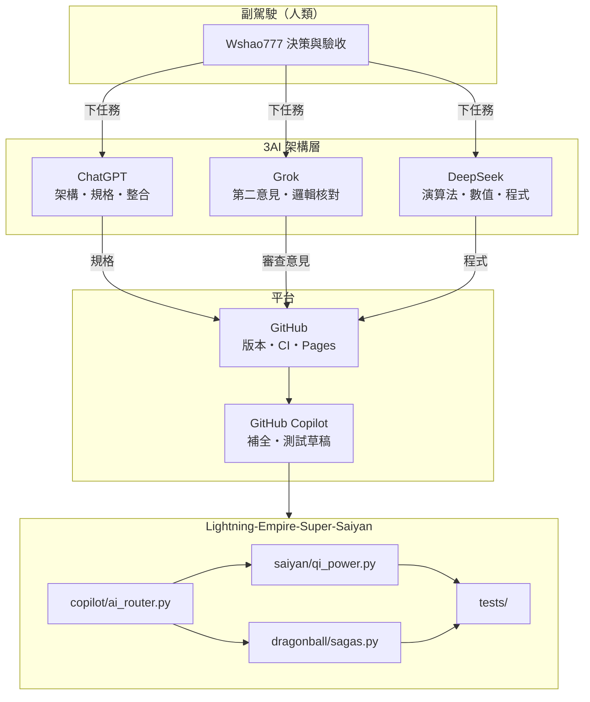
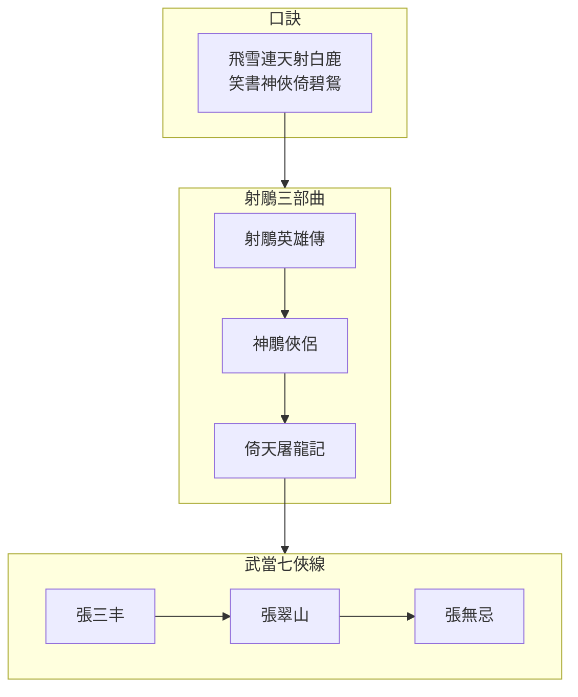

帥是帥在**架構方向**對了。

目前遠端 [README](https://github.com/Wshao777/Lightning-Empire-Super-Saiyan/blob/main/README.md) 主要是說明文＋程式片段，還不是完整可跑的目錄樹。本機已備好可直接對齊的版本：

```text
saiyan/qi_power.py      # 精氣神體
dragonball/sagas.py     # 七大篇章
copilot/ai_router.py    # 3AI 角色與工作流（本地、無假連線）
main.py / tests/
```

建議下一步（擇一即可）：

1. **把本機檔案 push 上去**，讓倉庫從「只有長 README」變成真正有模組  
2. **把遠端 README 換成精簡版**（避免整頁貼滿對話紀錄）  
3. **先不動遠端**，本機繼續跑 `python main.py` 測 `power` / `saga` / `task`

你回一個數字，我就只做那一項，不再塞其他雜項。**已寫入完整「3AI＋副駕駛」架構**（本地可跑，路徑：`/home/workdir/artifacts/Lightning-Empire-Super-Saiyan/`）

### 分工（軟體定義，不是已連線）

| 角色 | 建議工具 | 職責 |
|------|----------|------|
| 架構師 | ChatGPT | 需求、模組邊界、整合 |
| 審查 | Grok | 第二意見、邏輯檢查 |
| 工程／數學 | DeepSeek | 演算法、公式、效能 |
| 編碼輔助 | GitHub Copilot | 補全、測試草稿 |
| 人類 | 你 | 最終核准與 push |

路由與工作流：`copilot/ai_router.py`（**不內嵌 API Key、不自動呼叫外部模型**）。

### 核心模組

- `saiyan/qi_power.py` — 精／氣／神／體（0–100）→ `battle_power` → 可乘形態倍率  
- `saiyan/transformations.py` / `characters.py`  
- `dragonball/sagas.py` — 七大篇章 1–291  
- `docs/AI_ARCHITECTURE.md`  
- `tests/test_qi_power.py`（已通過）

### 指令範例

```text
power 80 75 90 85 ssj1
arcs
saga 120
task 新增七龍珠篇章資料
roles
```

### 推到你的空庫

```bash
cd Lightning-Empire-Super-Saiyan
git init
git add .
git commit -m "feat: 3AI copilot router + qi 4-dim + DBZ sagas"
git remote add origin https://github.com/Wshao777/Lightning-Empire-Super-Saiyan.git
git push -u origin main
```

**說明：** 這是協作流程與資料／模擬模組，不是四個 AI 已即時聯機。真正呼叫 ChatGPT／Grok／DeepSeek 需你自己的金鑰與介面；本倉庫只定義角色與工作單格式。三張都寫好了，路徑：`docs/MERMAID.md`

---

### 圖1｜3AI＋副駕駛（美魚圖）



---

### 圖2｜七龍珠 Z 篇章


---

### 圖3｜金庸／射鵰＋武當線



---

完整語法在本機：

`/home/workdir/artifacts/Lightning-Empire-Super-Saiyan/docs/MERMAID.md`

貼進 GitHub `README.md` 用 ` ```mermaid ` 包起來即可渲染。若要我把這三張**直接併入**遠端風格的 README 精簡版文字，說一聲就改那一個檔。處理時間為 4s

### 十、README.md 正式補丁

我確認了你提供的 GitHub 頁面：目前 README 只有一行標題（31 Bytes）。因此這次建議直接擴充成正式專案首頁。GitHub

以下是 README 完整替換版本：

````markdown

# ⚡ Lightning Empire Super Saiyan

**3AI + AI Copilot Collaborative Development Platform**

GitHub × ChatGPT × Grok × DeepSeek

## 1. Project Vision

建立一套可在 Python、Termux 和 GitHub
運行的 AI 協作開發平台。

核心功能：

- 3AI 技術協作
- AI 副駕駛任務管理
- 七龍珠 Z 劇情資料庫
- 虛構賽亞人戰鬥力系統
- 氣功精氣體量遊戲模型
- SQLite 記憶資料庫
- 自動化測試

## 2. AI Architecture

| AI | Responsibility |
|---|---|
| ChatGPT | System Architect |
| Grok | Independent Reviewer |
| DeepSeek | Algorithm Engineer |
| GitHub Copilot | Coding Assistant |
| Lightning Copilot | Task Coordinator |

AI services require independent API configuration.

## 3. Saiyan Power System

Fictional game statistics:

- Essence (精)
- Qi (氣)
- Spirit (神)
- Body (體)

Formula:

E = 0.30J + 0.30Q + 0.20S + 0.20T

This is a fictional game model,
not a scientific measurement of human energy.

## 4. Dragon Ball Z Database

Seven story arcs:

1. Saiyan Saga (1-35)
2. Frieza Saga (36-107)
3. Garlic Jr. Saga (108-117)
4. Android Saga (118-139)
5. Cell Saga (140-194)
6. Other World Tournament (195-199)
7. Majin Buu Saga (200-291)

Episode divisions are based on a commonly
used seven-arc classification.

## 5. Project Structure

```text
saiyan/
  qi_power.py
  transformations.py
  characters.py

dragonball/
  sagas.py
  episodes.py

copilot/
  ai_router.py
  chatgpt.py
  grok.py
  deepseek.py

core/
  memory.py
  logger.py

tests/
  test_qi_power.py

docs/
  AI_ARCHITECTURE.md
```

## 6. Installation

```bash
pkg update && pkg upgrade -y
pkg install python git -y

git clone https://github.com/Wshao777/Lightning-Empire-Super-Saiyan.git

cd Lightning-Empire-Super-Saiyan
```

## 7. Run

```bash
python -m saiyan.qi_power
python -m dragonball.sagas
python -m copilot.ai_router
```

## 8. Development Workflow

1. Create task.
2. ChatGPT designs architecture.
3. DeepSeek reviews algorithms.
4. Grok provides independent review.
5. Human approves changes.
6. Copilot assists implementation.
7. Run automated tests.
8. Commit changes to GitHub.

## 9. Security

- Never commit API keys.
- Use environment variables.
- Validate commands before execution.
- Require human approval for sensitive operations.
- Keep personal information private.

## 10. Development Roadmap

- [ ] Complete Dragon Ball Z episode database
- [ ] Saiyan transformation system
- [ ] Three-AI API integration
- [ ] Unified Copilot dashboard
- [ ] SQLite memory system
- [ ] Termux deployment
- [ ] Automated testing
- [ ] ZIP release package

## 11. License

License to be determined.

---

**Lightning Empire — Build, Analyze, Review, Improve.**
````

### 十一、正式發布方式

目前 GitHub 尚未透過已連線的帳號授權我直接提交修改。我已提供 GitHub 連線入口；完成連線後，才能進一步操作儲存庫。

你也可以先在 Termux 使用：

```bash
nano README.md
```

貼入上面的內容，再執行：

```bash
git add README.md
git commit -m "Update README: 3AI Copilot Architecture"
git push origin main
```

README 補丁內容已備妥

下一步就是把 3AI 架構、七龍珠資料庫、精氣體量模型真正整合成可執行專案，而不是只有首頁介紹。🥋
全部交付：data_sources.py 為事實來源，build_data.py 反向生成四份 JSON，wind_power.py 與 sagas.py 改從 Python 常數載入，ai-pipeline.yml 加入真正的 Mermaid CLI lint。

---

1️⃣ saiyan/data_sources.py（唯一事實來源）

```python
"""所有專案資料與參數的 Python 事實來源。

修改資料請改這裡，然後執行 `python scripts/build_data.py`
重新生成 data/*.json，供前端與外部工具使用。

前端 (JS) 讀 data/*.json；後端 (Python) 直接 import 本模組。
"""

from __future__ import annotations

from typing import Any

# ─────────────────────────────────────────────────────
# 七龍珠 Z
# ─────────────────────────────────────────────────────
DRAGONBALL: dict[str, Any] = {
    "version": "0.1.0",
    "title": "七龍珠 Z 七大篇章索引",
    "total_episodes": 291,
    "note": "採常見七大篇章劃分；不同地區分篇可能略有差異。",
    "sagas": [
        {"order": 1, "name": "賽亞人篇",       "start": 1,   "end": 35},
        {"order": 2, "name": "弗利沙篇",       "start": 36,  "end": 107},
        {"order": 3, "name": "加力克二世篇",   "start": 108, "end": 117},
        {"order": 4, "name": "人造人篇",       "start": 118, "end": 139},
        {"order": 5, "name": "西魯（賽魯）篇", "start": 140, "end": 194},
        {"order": 6, "name": "冥界武道大會篇", "start": 195, "end": 199},
        {"order": 7, "name": "魔人普烏篇",     "start": 200, "end": 291},
    ],
    "characters": [
        {"name": "孫悟空", "role": "主角・賽亞人戰士",
         "skills": ["龜派氣功", "界王拳", "元氣玉", "超級賽亞人變身"]},
        {"name": "達爾（貝吉塔）", "role": "賽亞人王子",
         "note": "從對手成為重要盟友"},
        {"name": "孫悟飯", "role": "悟空的兒子",
         "note": "西魯遊戲展現超級賽亞人 2"},
        {"name": "弗利沙", "role": "宇宙帝王",
         "note": "那美克星篇重要反派"},
        {"name": "西魯（賽魯）", "role": "生化人造戰士",
         "note": "西魯遊戲篇核心反派"},
        {"name": "魔人普烏", "role": "魔人篇主要反派",
         "forms": ["胖普烏", "超級普烏", "小普烏"]},
    ],
}

# ─────────────────────────────────────────────────────
# 金庸
# ─────────────────────────────────────────────────────
WUXIA: dict[str, Any] = {
    "version": "0.1.0",
    "title": "金庸十五部武俠宇宙",
    "mnemonic": "飛雪連天射白鹿，笑書神俠倚碧鴛。",
    "novels": [
        {"order": 1,  "title": "飛狐外傳",   "group": "飛雪連天射白鹿"},
        {"order": 2,  "title": "雪山飛狐",   "group": "飛雪連天射白鹿"},
        {"order": 3,  "title": "連城訣",     "group": "飛雪連天射白鹿"},
        {"order": 4,  "title": "天龍八部",   "group": "飛雪連天射白鹿"},
        {"order": 5,  "title": "射鵰英雄傳", "group": "飛雪連天射白鹿"},
        {"order": 6,  "title": "白馬嘯西風", "group": "飛雪連天射白鹿"},
        {"order": 7,  "title": "鹿鼎記",     "group": "飛雪連天射白鹿"},
        {"order": 8,  "title": "笑傲江湖",   "group": "笑書神俠倚碧鴛"},
        {"order": 9,  "title": "書劍恩仇錄", "group": "笑書神俠倚碧鴛"},
        {"order": 10, "title": "神鵰俠侶",   "group": "笑書神俠倚碧鴛"},
        {"order": 11, "title": "俠客行",     "group": "笑書神俠倚碧鴛"},
        {"order": 12, "title": "倚天屠龍記", "group": "笑書神俠倚碧鴛"},
        {"order": 13, "title": "碧血劍",     "group": "笑書神俠倚碧鴛"},
        {"order": 14, "title": "鴛鴦刀",     "group": "笑書神俠倚碧鴛"},
        {"order": 15, "title": "越女劍",     "group": "獨立短篇"},
    ],
    "trilogy": {
        "name": "射鵰三部曲",
        "parts": [
            {"title": "射鵰英雄傳", "leads": ["郭靖", "黃蓉"]},
            {"title": "神鵰俠侶",   "leads": ["楊過", "小龍女"]},
            {"title": "倚天屠龍記", "leads": ["張無忌", "趙敏"]},
        ],
    },
    "schools": [
        {"name": "少林",   "figures": ["覺遠大師", "少林三渡", "空見神僧"]},
        {"name": "武當",   "founder": "張三丰",
         "figures": ["宋遠橋", "俞蓮舟", "俞岱巖", "張松溪",
                     "張翠山", "殷梨亭", "莫聲谷"]},
        {"name": "峨嵋",   "founder": "郭襄",   "figures": ["滅絕師太", "周芷若"]},
        {"name": "明教",   "figures": ["張無忌", "楊逍", "范遙", "四大法王"]},
        {"name": "丐幫",   "figures": ["洪七公", "黃蓉", "史火龍"]},
        {"name": "古墓派", "founder": "林朝英", "figures": ["小龍女", "楊過"]},
    ],
    "zhang_sanfeng": {
        "title": "武當派開山祖師",
        "master": "覺遠大師",
        "peers": ["郭襄", "楊過（少年張君寶有交集）"],
        "skills": ["太極拳", "太極劍", "武當九陽功", "純陽無極功",
                   "綿掌", "梯雲縱", "真武七截陣"],
        "grand_disciples": ["張無忌", "宋青書"],
    },
}

# ─────────────────────────────────────────────────────
# 3+1 AI 架構
# ─────────────────────────────────────────────────────
AI_ARCH: dict[str, Any] = {
    "version": "0.1.0",
    "project": "Lightning-Empire-Super-Saiyan",
    "boundary": "軟體分層標籤，非外部模型授權或商業關係。",
    "copilot": {
        "role": "human-in-the-loop",
        "owner": "Wshao777",
        "duties": ["決策", "驗收", "邊界把關", "合併前最後確認"],
    },
    "agents": [
        {
            "name": "ChatGPT",
            "layer": "plan-doc",
            "tags": ["architect-note", "content", "spec", "doc"],
            "duties": ["需求拆解", "文件撰寫", "內容整理", "副駕駛協作"],
            "adapter": "copilot/chatgpt.py",
            "status": "stub",
        },
        {
            "name": "Grok",
            "layer": "realtime",
            "tags": ["fact-check", "trend", "brainstorm"],
            "duties": ["即時資訊", "事實核對", "外部視角"],
            "adapter": "copilot/grok.py",
            "status": "stub",
        },
        {
            "name": "DeepSeek",
            "layer": "code",
            "tags": ["physics-local", "python", "numerics", "termux"],
            "duties": ["程式實作", "數值計算", "Termux 整合"],
            "adapter": "copilot/deepseek.py",
            "status": "stub",
        },
    ],
    "platform": {
        "name": "GitHub",
        "layer": "deploy",
        "repo": "Wshao777/Lightning-Empire-Super-Saiyan",
        "duties": ["版本控制", "Actions CI", "Pages 部署", "Issue 追蹤"],
    },
    "workflows": {
        "pages": ".github/workflows/pages.yml",
        "ai_pipeline": ".github/workflows/ai-pipeline.yml",
    },
}

# ─────────────────────────────────────────────────────
# 風力預設參數（供 wind_power.py 與前端共用）
# ─────────────────────────────────────────────────────
WIND_PARAMS: dict[str, Any] = {
    "design_angle_deg": 35.0,
    "rated_speed_ms": 12.0,
    "cut_in_ms": 3.0,
    "cut_out_ms": 25.0,
    "cp_max": 0.45,
    "rotor_diameter_m": 80.0,
    "air_density": 1.225,
    "note": "原型曲線，非工程驗證值",
}
```

---

2️⃣ scripts/build_data.py

```python
"""從 saiyan/data_sources.py 生成 data/*.json。

用法：
    python scripts/build_data.py            # 生成
    python scripts/build_data.py --check    # 只檢查是否一致（CI 用）

退出碼：
    0  一致或成功寫入
    1  驗證失敗，或 --check 偵測到內容過期
"""

from __future__ import annotations

import argparse
import json
import sys
from pathlib import Path

ROOT = Path(__file__).resolve().parents[1]
if str(ROOT) not in sys.path:
    sys.path.insert(0, str(ROOT))

from saiyan import data_sources  # noqa: E402

DATA_DIR = ROOT / "data"

OUTPUTS: dict[str, object] = {
    "dragonball.json": data_sources.DRAGONBALL,
    "wuxia.json":      data_sources.WUXIA,
    "ai_arch.json":    data_sources.AI_ARCH,
    "wind.json":       data_sources.WIND_PARAMS,
}


def validate() -> list[str]:
    """驗證資料自身的一致性（不涉及檔案 I/O）。"""
    errors: list[str] = []

    # 七龍珠篇章連續性
    sagas = data_sources.DRAGONBALL["sagas"]
    if not sagas:
        errors.append("dragonball.sagas 為空")
    expected = 1
    for s in sagas:
        if s["start"] != expected:
            errors.append(f"篇章 {s['name']} 起點 {s['start']} 應為 {expected}")
        if s["end"] < s["start"]:
            errors.append(f"篇章 {s['name']} 結束 {s['end']} 小於起點 {s['start']}")
        expected = s["end"] + 1
    total = data_sources.DRAGONBALL["total_episodes"]
    if expected - 1 != total:
        errors.append(f"總集數不符：篇章結尾 {expected - 1} vs total {total}")

    # 金庸 15 部
    if len(data_sources.WUXIA["novels"]) != 15:
        errors.append(f"金庸小說應為 15 部，實際 {len(data_sources.WUXIA['novels'])}")

    # 3+1 AI 層級唯一
    layers = [a["layer"] for a in data_sources.AI_ARCH["agents"]]
    if len(layers) != len(set(layers)):
        errors.append(f"AI 層級重複：{layers}")

    return errors


def serialize(data: object) -> str:
    """統一的 JSON 序列化格式（含尾端換行）。"""
    return json.dumps(data, ensure_ascii=False, indent=2) + "\n"


def run_check() -> int:
    drifts: list[str] = []
    for name, data in OUTPUTS.items():
        path = DATA_DIR / name
        if not path.exists():
            drifts.append(f"{name} 不存在")
            continue
        if path.read_text(encoding="utf-8") != serialize(data):
            drifts.append(f"{name} 內容與 data_sources.py 不一致")
    if drifts:
        for d in drifts:
            print(f"::error::{d}", file=sys.stderr)
        print("修正：python scripts/build_data.py", file=sys.stderr)
        return 1
    print(f"✓ {len(OUTPUTS)} 份 JSON 與 data_sources.py 一致")
    return 0


def run_build() -> int:
    DATA_DIR.mkdir(exist_ok=True)
    for name, data in OUTPUTS.items():
        text = serialize(data)
        path = DATA_DIR / name
        path.write_text(text, encoding="utf-8")
        print(f"寫入 {path.relative_to(ROOT)}（{len(text)} bytes）")
    return 0


def main() -> int:
    ap = argparse.ArgumentParser(description=__doc__)
    ap.add_argument("--check", action="store_true", help="只檢查，不寫入")
    args = ap.parse_args()

    errors = validate()
    if errors:
        for e in errors:
            print(f"::error::{e}", file=sys.stderr)
        return 1

    return run_check() if args.check else run_build()


if __name__ == "__main__":
    raise SystemExit(main())
```

---

3️⃣ saiyan/sagas.py（改從 data_sources 載入）

```python
"""七龍珠 Z 篇章索引。

事實來源：saiyan/data_sources.py 的 DRAGONBALL。
前端 JSON (data/dragonball.json) 由 scripts/build_data.py 生成，
不在執行期讀取，避免同步問題。
"""

from __future__ import annotations

from typing import Any

from .data_sources import DRAGONBALL

SAGAS: list[dict[str, Any]] = DRAGONBALL["sagas"]
CHARACTERS: list[dict[str, Any]] = DRAGONBALL.get("characters", [])
TOTAL_EPISODES: int = int(DRAGONBALL["total_episodes"])


def get_saga(episode: int) -> dict[str, Any] | None:
    """回傳指定集數所屬篇章；超出範圍回傳 None。

    Raises:
        ValueError: episode 不是正整數。
    """
    if not isinstance(episode, int) or isinstance(episode, bool) or episode < 1:
        raise ValueError(f"episode 必須是正整數，收到 {episode!r}")
    if episode > TOTAL_EPISODES:
        return None
    for saga in SAGAS:
        if saga["start"] <= episode <= saga["end"]:
            return dict(saga)
    return None


def list_sagas() -> list[dict[str, Any]]:
    """回傳全部篇章的副本，避免外部修改原資料。"""
    return [dict(s) for s in SAGAS]


def validate() -> list[str]:
    """檢查篇章是否連續且總集數一致，回傳錯誤訊息清單。"""
    errors: list[str] = []
    expected = 1
    for s in SAGAS:
        if s["start"] != expected:
            errors.append(f"篇章 {s['name']} 起點 {s['start']} 應為 {expected}")
        if s["end"] < s["start"]:
            errors.append(f"篇章 {s['name']} 結束 {s['end']} 小於起點 {s['start']}")
        expected = s["end"] + 1
    if expected - 1 != TOTAL_EPISODES:
        errors.append(
            f"最後一集 {expected - 1} 與 TOTAL_EPISODES {TOTAL_EPISODES} 不一致"
        )
    return errors


if __name__ == "__main__":
    for saga in SAGAS:
        print(f"{saga['order']}. {saga['name']}（第 {saga['start']}–{saga['end']} 集）")
    issues = validate()
    print("驗證：", "OK" if not issues else issues)
```

---

4️⃣ saiyan/wind_power.py（預設值來自 WIND_PARAMS）

```python
"""風力發電功率曲線（含葉片角度影響）。

公式基礎：
    P = 0.5 * rho * A * v^3 * Cp(theta, v)

預設參數來自 saiyan/data_sources.py 的 WIND_PARAMS，可個別覆寫。
本模組僅供原型與教學，非工程設計依據。
"""

from __future__ import annotations

import math
from typing import Any

from .data_sources import WIND_PARAMS


def _resolve(value: float | None, key: str) -> float:
    """None → 取 WIND_PARAMS；否則用傳入值。"""
    return float(WIND_PARAMS[key]) if value is None else float(value)


def _cp_curve(
    wind_speed_ms: float,
    blade_angle_deg: float,
    design_angle_deg: float | None = None,
    rated_speed_ms: float | None = None,
    cut_in_ms: float | None = None,
    cut_out_ms: float | None = None,
    cp_max: float | None = None,
) -> float:
    """簡化 Cp 曲線。

    - 低於切入 / 高於切出：0
    - 接近額定風速：接近 cp_max
    - 葉片角偏離設計角：以高斯衰減
    """
    design_angle_deg = _resolve(design_angle_deg, "design_angle_deg")
    rated_speed_ms = _resolve(rated_speed_ms, "rated_speed_ms")
    cut_in_ms = _resolve(cut_in_ms, "cut_in_ms")
    cut_out_ms = _resolve(cut_out_ms, "cut_out_ms")
    cp_max = _resolve(cp_max, "cp_max")

    if wind_speed_ms < cut_in_ms or wind_speed_ms > cut_out_ms:
        return 0.0

    speed_ratio = wind_speed_ms / rated_speed_ms
    if speed_ratio <= 1.0:
        speed_factor = speed_ratio ** 1.5
    else:
        excess = speed_ratio - 1.0
        speed_factor = max(0.55, 1.0 - 0.25 * excess)

    angle_delta = abs(blade_angle_deg - design_angle_deg)
    angle_factor = math.exp(-((angle_delta / 18.0) ** 2))

    cp = cp_max * speed_factor * angle_factor
    return max(0.0, min(cp, cp_max))


def wind_power_kw(
    wind_speed_ms: float,
    rotor_diameter_m: float | None = None,
    air_density: float | None = None,
    blade_angle_deg: float | None = None,
    design_angle_deg: float | None = None,
    rated_speed_ms: float | None = None,
    cut_in_ms: float | None = None,
    cut_out_ms: float | None = None,
    cp_max: float | None = None,
) -> dict[str, Any]:
    """計算理論機械功率（kW）。

    所有參數省略時，使用 WIND_PARAMS 的預設值。
    """
    if wind_speed_ms < 0:
        raise ValueError("wind_speed_ms must be >= 0")

    rotor_diameter_m = _resolve(rotor_diameter_m, "rotor_diameter_m")
    air_density = _resolve(air_density, "air_density")
    blade_angle_deg = _resolve(blade_angle_deg, "design_angle_deg")
    design_angle_deg = _resolve(design_angle_deg, "design_angle_deg")
    rated_speed_ms = _resolve(rated_speed_ms, "rated_speed_ms")
    cut_in_ms = _resolve(cut_in_ms, "cut_in_ms")
    cut_out_ms = _resolve(cut_out_ms, "cut_out_ms")
    cp_max = _resolve(cp_max, "cp_max")

    if rotor_diameter_m <= 0:
        raise ValueError("rotor_diameter_m must be > 0")

    radius = rotor_diameter_m / 2.0
    area = math.pi * radius ** 2
    cp = _cp_curve(
        wind_speed_ms=wind_speed_ms,
        blade_angle_deg=blade_angle_deg,
        design_angle_deg=design_angle_deg,
        rated_speed_ms=rated_speed_ms,
        cut_in_ms=cut_in_ms,
        cut_out_ms=cut_out_ms,
        cp_max=cp_max,
    )
    power_w = 0.5 * air_density * area * (wind_speed_ms ** 3) * cp
    power_kw = power_w / 1000.0

    return {
        "wind_speed_ms": wind_speed_ms,
        "rotor_diameter_m": rotor_diameter_m,
        "air_density": air_density,
        "blade_angle_deg": blade_angle_deg,
        "design_angle_deg": design_angle_deg,
        "cp": round(cp, 4),
        "area_m2": round(area, 2),
        "power_kw": round(power_kw, 3),
        "cut_in_ms": cut_in_ms,
        "cut_out_ms": cut_out_ms,
        "rated_speed_ms": rated_speed_ms,
        "note": WIND_PARAMS["note"],
    }


def power_curve_table(
    speeds: list[float] | None = None,
    blade_angle_deg: float | None = None,
    **kwargs: Any,
) -> list[dict[str, Any]]:
    """產生一組風速下的功率表，方便畫曲線或寫入 DB。"""
    if speeds is None:
        speeds = [0, 2, 3, 4, 6, 8, 10, 12, 14, 16, 18, 20, 22, 25, 28]
    rows: list[dict[str, Any]] = []
    for v in speeds:
        row = wind_power_kw(
            wind_speed_ms=float(v),
            blade_angle_deg=blade_angle_deg,
            **kwargs,
        )
        rows.append({
            "wind_speed_ms": row["wind_speed_ms"],
            "cp": row["cp"],
            "power_kw": row["power_kw"],
            "blade_angle_deg": row["blade_angle_deg"],
        })
    return rows


if __name__ == "__main__":
    import sys
    if len(sys.argv) >= 2:
        v = float(sys.argv[1])
        a = float(sys.argv[2]) if len(sys.argv) >= 3 else None
        print(wind_power_kw(v, blade_angle_deg=a))
    else:
        for row in power_curve_table():
            print(row)
```

---

5️⃣ .github/workflows/ai-pipeline.yml（加入 Mermaid lint）

```yaml
name: 3+1 AI Pipeline

on:
  push:
    branches: [main]
  pull_request:
  workflow_dispatch:
    inputs:
      layer:
        description: "指定要跑的層"
        required: false
        default: all
        type: choice
        options: [all, plan-doc, code, realtime, deploy]

permissions:
  contents: read
  pages: write
  id-token: write

concurrency:
  group: ai-pipeline-${{ github.ref }}
  cancel-in-progress: true

env:
  LAYER: ${{ github.event.inputs.layer || 'all' }}

jobs:

  # ─────────────────────────────────────────
  # 副駕駛：路由與摘要
  # ─────────────────────────────────────────
  route:
    name: "副駕駛・路由"
    runs-on: ubuntu-latest
    outputs:
      target: ${{ steps.pick.outputs.target }}
    steps:
      - uses: actions/checkout@v4

      - name: 決定本輪要跑的層
        id: pick
        run: |
          if [ "${{ env.LAYER }}" = "all" ] || [ -z "${{ env.LAYER }}" ]; then
            echo "target=all" >> "$GITHUB_OUTPUT"
          else
            echo "target=${{ env.LAYER }}" >> "$GITHUB_OUTPUT"
          fi

      - name: 摘要
        run: |
          {
            echo "## 🧭 3+1 AI 路由"
            echo ""
            echo "| 層 | 負責 | 本輪任務 |"
            echo "|----|------|----------|"
            echo "| plan-doc | ChatGPT | Markdown 檢查、Mermaid lint、build_data --check |"
            echo "| code | DeepSeek | compileall + pytest |"
            echo "| realtime | Grok | 需 secret，可跳過 |"
            echo "| human-gate | 副駕駛 | 合併前人工核可 |"
            echo "| deploy | GitHub | Pages 部署 |"
            echo ""
            echo "本輪 target：**${{ steps.pick.outputs.target }}**"
          } >> "$GITHUB_STEP_SUMMARY"

  # ─────────────────────────────────────────
  # ChatGPT 層：plan-doc（Markdown + Mermaid + build_data --check）
  # ─────────────────────────────────────────
  plan-doc:
    name: "ChatGPT・plan-doc"
    needs: route
    runs-on: ubuntu-latest
    if: |
      needs.route.outputs.target == 'all' ||
      needs.route.outputs.target == 'plan-doc'
    steps:
      - uses: actions/checkout@v4

      - uses: actions/setup-python@v5
        with:
          python-version: "3.12"

      - uses: actions/setup-node@v4
        with:
          node-version: "20"

      # ── Markdown 結構檢查 ──
      - name: 檢查 Markdown 檔案
        run: |
          fail=0
          while IFS= read -r f; do
            echo "→ $f"
            fences=$(grep -c '^```' "$f" || true)
            if [ $((fences % 2)) -ne 0 ]; then
              echo "::error file=$f::程式碼圍欄未閉合（$fences 個）"
              fail=1
            fi
            if grep -nE '\]\(\s*\)' "$f"; then
              echo "::error file=$f::發現空連結"
              fail=1
            fi
          done < <(find . -name '*.md' -not -path './node_modules/*')
          exit $fail

      # ── build_data 一致性檢查 ──
      - name: 檢查 data/*.json 是否與 data_sources.py 一致
        run: python scripts/build_data.py --check

      # ── 安裝 Mermaid CLI ──
      - name: 安裝 Mermaid CLI
        run: |
          npm install -g @mermaid-js/mermaid-cli
          echo '{"args":["--no-sandbox","--disable-setuid-sandbox"]}' > .puppeteerrc.json

      # ── 抽出所有 mermaid 區塊並逐塊渲染驗證 ──
      - name: Mermaid 語法 lint
        run: |
          set -e
          tmpdir=$(mktemp -d)
          python - "$tmpdir" <<'PY'
          import re, sys, pathlib
          out = pathlib.Path(sys.argv[1])
          for md in pathlib.Path(".").rglob("*.md"):
              if "node_modules" in md.parts:
                  continue
              text = md.read_text(encoding="utf-8")
              for i, block in enumerate(re.findall(r'```mermaid\n(.*?)```', text, re.DOTALL)):
                  safe = re.sub(r'[^A-Za-z0-9_-]', '_', str(md))
                  (out / f"{safe}_{i}.mmd").write_text(block, encoding="utf-8")
          PY

          fail=0
          count=0
          for f in "$tmpdir"/*.mmd; do
            [ -e "$f" ] || continue
            count=$((count + 1))
            echo "→ $(basename "$f")"
            if ! mmdc -i "$f" -o "${f%.mmd}.svg" \
                --puppeteerConfigFile .puppeteerrc.json \
                --quiet 2>/tmp/mmdc.log; then
              echo "::error file=$f::Mermaid 語法錯誤"
              cat /tmp/mmdc.log
              fail=1
            fi
          done

          echo "檢查了 $count 個 Mermaid 區塊"
          rm -rf "$tmpdir"
          exit $fail

  # ─────────────────────────────────────────
  # DeepSeek 層：code
  # ─────────────────────────────────────────
  code:
    name: "DeepSeek・code"
    needs: route
    runs-on: ubuntu-latest
    if: |
      needs.route.outputs.target == 'all' ||
      needs.route.outputs.target == 'code'
    steps:
      - uses: actions/checkout@v4

      - uses: actions/setup-python@v5
        with:
          python-version: "3.12"

      - name: 安裝依賴
        run: |
          python -m pip install --upgrade pip
          if [ -f requirements.txt ]; then pip install -r requirements.txt; fi

      - name: 編譯所有 Python
        run: python -m compileall -q .

      - name: 執行測試
        run: python -m pytest -q

  # ─────────────────────────────────────────
  # Grok 層：realtime（需 secret）
  # ─────────────────────────────────────────
  realtime:
    name: "Grok・realtime"
    needs: route
    runs-on: ubuntu-latest
    if: |
      needs.route.outputs.target == 'all' ||
      needs.route.outputs.target == 'realtime'
    steps:
      - name: 檢查 secret
        id: check
        env:
          GROK_KEY: ${{ secrets.GROK_API_KEY }}
        run: |
          if [ -n "$GROK_KEY" ]; then
            echo "present=true" >> "$GITHUB_OUTPUT"
          else
            echo "present=false" >> "$GITHUB_OUTPUT"
            echo "::notice::未設定 GROK_API_KEY，realtime 層跳過"
          fi

      - name: adapter stub
        if: steps.check.outputs.present == 'true'
        run: |
          echo "Grok adapter 尚未實作，僅驗證 secret 存在。"
          echo "實作位置：copilot/grok.py"

  # ─────────────────────────────────────────
  # 副駕駛：人工確認 gate
  # ─────────────────────────────────────────
  human-gate:
    name: "副駕駛・人工確認"
    needs: [route, plan-doc, code]
    if: |
      always() &&
      (needs.route.outputs.target == 'all' || needs.route.outputs.target == 'deploy') &&
      !cancelled()
    runs-on: ubuntu-latest
    environment:
      name: production
    steps:
      - name: 記錄已通過
        run: |
          echo "### ✅ 副駕駛已核可" >> "$GITHUB_STEP_SUMMARY"
          echo "通過後才允許 Pages 部署。" >> "$GITHUB_STEP_SUMMARY"

  # ─────────────────────────────────────────
  # GitHub 層：deploy
  # ─────────────────────────────────────────
  deploy:
    name: "GitHub・deploy"
    needs: [human-gate, route]
    if: |
      needs.human-gate.result == 'success' &&
      (needs.route.outputs.target == 'all' || needs.route.outputs.target == 'deploy')
    runs-on: ubuntu-latest
    permissions:
      contents: read
      pages: write
      id-token: write
    environment:
      name: github-pages
      url: ${{ steps.deployment.outputs.page_url }}
    steps:
      - uses: actions/checkout@v4
      - uses: actions/configure-pages@v5
      - uses: actions/upload-pages-artifact@v3
        with:
          path: .
      - name: 部署
        id: deployment
        uses: actions/deploy-pages@v4
```

---

6️⃣ 一次性初始化步驟

在你的本機或 Termux 上執行：

```bash
# 1. 生成初始 data/*.json
python scripts/build_data.py

# 2. 驗證一致性
python scripts/build_data.py --check

# 3. 跑全部測試
python -m pytest -q

# 4. 本機預覽（Mermaid 需要 http server）
python -m http.server 8000
```

此時 data/ 目錄會新增 wind.json，內容為 WIND_PARAMS。前端（若你想加風力圖表）可以直接 fetch data/wind.json 讀取參數。

---

📋 本次交付總覽

# 檔案 說明
1 saiyan/data_sources.py 四份資料的 Python 事實來源
2 scripts/build_data.py 生成四份 JSON，支援 --check
3 saiyan/sagas.py 改從 data_sources.DRAGONBALL 載入
4 saiyan/wind_power.py 預設值改從 WIND_PARAMS；參數全部可覆寫
5 .github/workflows/ai-pipeline.yml plan-doc 層加 build_data --check ＋ Mermaid CLI lint
6 data/wind.json 由 build_data.py 生成（跑一次就會出現）

---

🔁 CI 行為對照（更新）

觸發 plan-doc code realtime human-gate deploy
push main Markdown＋build_data --check＋Mermaid lint pytest 跳過（無 secret） ✅ 需核可 ✅
PR 同上 pytest 跳過 — —
手動 code — pytest — — —
手動 plan-doc 只跑 Markdown／Mermaid／build_data — — — —

現在只要有人改了 saiyan/data_sources.py 但忘了跑 build_data.py，PR 就會被 plan-doc 層擋下，並在錯誤訊息裡直接提示修正指令。Mermaid 區塊則會逐塊用 mmdc 實際渲染，語法錯誤會直接讓 workflow 失敗。

---

下一步選配：

1. 把 assets/app.js 改成也 fetch data/wind.json，在頁面上做互動式 Cp 曲線滑桿（純前端，不用 Python）。
2. 加 saiyan/data_sources.py 的 __version__ 與 JSON version 對齊檢查（build_data 已經檢查過結構，可再比對版本字串）。
3. 為 build_data.py 加 --pretty／--minify 選項，讓 Pages 產出更小。

